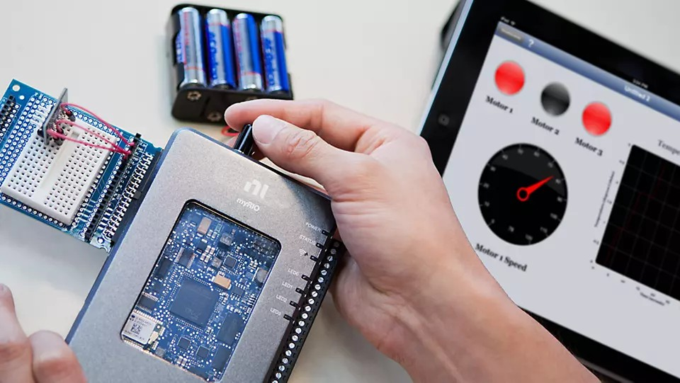
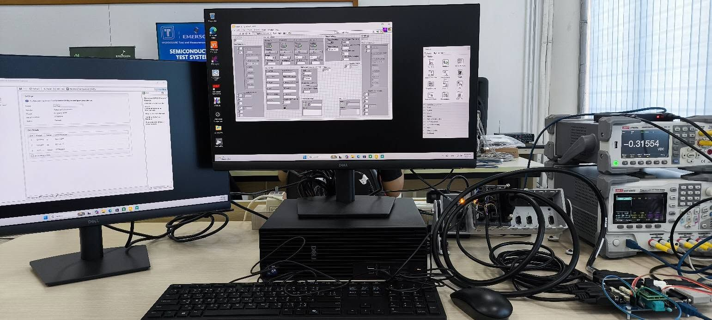
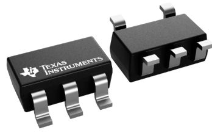
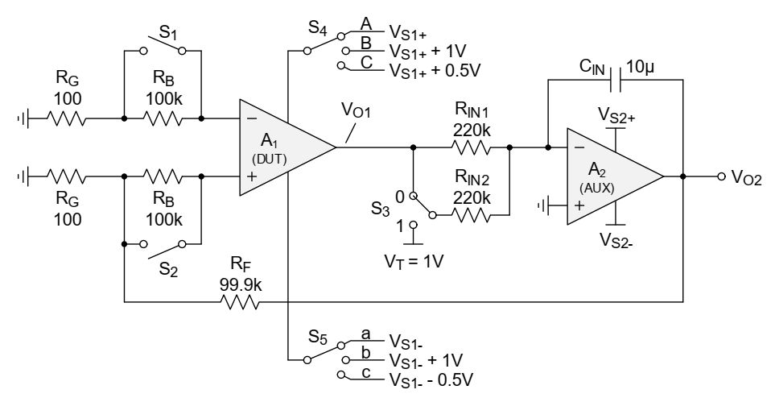
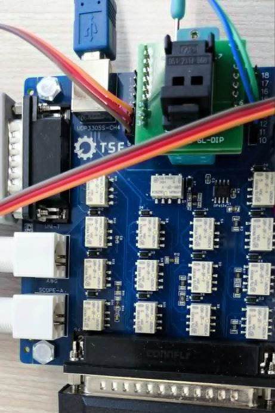

## Course outline {.smaller}

:::: {.columns}
::: {.column width=50%}
- [x] **วันที่ 1 LabVIEW + myRIO**
    - Automated Test Equipment
    - การเข้าจังหวะและส่งผ่านข้อมูลด้วย LabVIEW 
    - การสร้างสัญญาณทดสอบด้วย NI myRIO
    - **workshop**: การเชื่อมต่อ DUT
- [ ] **วันที่ 2 Instrument drivers**
    - การเชื่อมต่อเครื่องมือวัด
    - ไดรเวอร์ DAQmx และ VISA
    - การวิเคราะห์/บันทึกข้อมูล
    - **workshop**: การเชื่อมต่อและควบคุมเครื่องมือวัด
:::
::: {.column width=50%}
- [ ] **วันที่ 3 NI TestStand**
    - NI TestStand
    - Sequence และ action/test steps
    - การใช้งาน code module
    - **workshop**: การสร้าง sequence ทดสอบ
- [ ] **วันที่ 4 Testing in electronics industry**
    - กรณีศึกษาของการทดสอบในอุตสาหกรรม
    - **workshop**: LabVIEW + TestStand for opamp testing
:::
::::

## Training tools {.smaller}
:::: {.columns}
::: {.column width=50%}
#### [NI LabVIEW](https://www.ni.com/en/shop/labview)

- Graphical programming environment
- Connect to instruments via DAQmx, VISA, PXI, camera
- Use engineering analysis functions

#### [NI TestStand](https://www.ni.com/en/shop/electronic-test-instrumentation/application-software-for-electronic-test-and-instrumentation-category/what-is-teststand)
- Manage validation and production tests
- Build, organize, and monitor test sequences
- Support NI LabVIEW, C/C++, .NET, and Python as test code 
:::
::: {.column width=50%}
#### [NI myRIO](https://www.ni.com/en/shop/engineering-education/portable-student-devices/myrio-student-embedded-device/what-is-myrio.html) as DAQ hardware
{width=75%}\

#### [TSE](https://ece.engr.tu.ac.th/) automated test experiment
\

:::
::::

## Problem-based learning #1 {.smaller}

:::: {.columns}
::: {.column width=55%}
#### [ADS1115](https://www.ti.com/product/ADS1115) module as DUT

- 16-bit Delta-Sigma ADC: 
    - upto 860 samples/sec
- I2C interface:
    - 4 device addresses
- 2 differential or 4 single-ended inputs
- Programmable Gain Amplifier (PGA):
    - ±256mV to ±6.144V
- Supply voltage: upto 5.5V
- Comparator &rarr; ALERT/RDY pin
:::
::: {.column width=45%}
\
\
:::
::::

## Problem-based learning #2 {.smaller}

:::: {.columns}
::: {.column width=75%}
#### [LM321](https://www.ti.com/product/LM321) operational amplifier as DUT

- 3V < supply voltage < 30V
- Bandwidth: 1 MHz, slew rate: 0.5 V/µs
- Offset voltage: 7 mV, bias current: 0.25 µA

:::
::: {.column width=25%}
\
:::
::::

:::: {.columns}
::: {.column width=75%}
#### Servo-loop configuration
\
:::
::: {.column width=25%}
\
:::
::::

## Further learning {.smaller}
- [LabVIEW Community Edition](https://www.ni.com/en/shop/labview/select-edition/labview-community-edition.html) เป็นรุ่นสำหรับการเรียนรู้ด้วยตัวเอง
- [Getting Started with the LabVIEW Hobbyist Toolkit](https://knowledge.ni.com/KnowledgeArticleDetails?id=kA00Z0000019TmpSAE&l=en-TH): แพคเกจสำหรับเชื่อมต่อ LabVIEW กับบอร์ด Arduino และ Raspberry Pi
- [Element 14 LabVIEW Challenge Blogs](https://community.element14.com/products/devtools/ni-labview/b/labview-challenge-blogs): แนะนำ hardware abstraction layer เชื่อมต่อไมโครคอนโทรลเลอร์
- [PyVISA](https://pyvisa.readthedocs.io/en/latest/): ไลบรารี Python สำหรับควบคุมเครื่องมือวัดผ่าน NI VISA
- [nidaqmx](https://nidaqmx-python.readthedocs.io/en/stable/): ไลบรารี Python สำหรับอ่าน/สร้างสัญญาณผ่าน NI DAQmx

