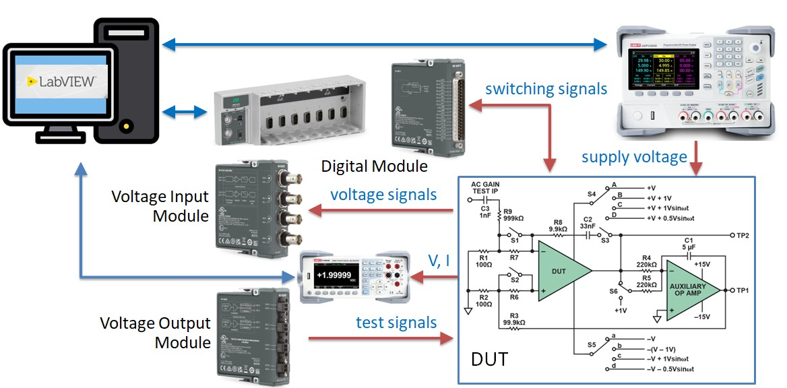
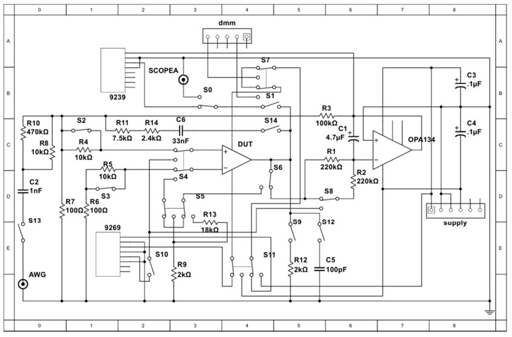

## Course outline {.smaller}

:::: {.columns}
::: {.column width=50%}
- [ ] **วันที่ 1 LabVIEW + myRIO**
    - Automated Test Equipment
    - การเข้าจังหวะและส่งผ่านข้อมูลด้วย LabVIEW 
    - การสร้างสัญญาณทดสอบด้วย NI myRIO
    - **workshop**: การเชื่อมต่อ DUT
- [x] **วันที่ 2 Instrument drivers**
    - การเชื่อมต่อเครื่องมือวัด
    - ไดรเวอร์ DAQmx และ VISA
    - การวิเคราะห์/บันทึกข้อมูล
    - **workshop**: การเชื่อมต่อและควบคุมเครื่องมือวัด
:::
::: {.column width=50%}
- [ ] **วันที่ 3 NI TestStand**
    - NI TestStand
    - Sequence และ action/test steps
    - การใช้งาน code module
    - **workshop**: การสร้าง sequence ทดสอบ
- [ ] **วันที่ 4 Testing in electronics industry**
    - กรณีศึกษาของการทดสอบในอุตสาหกรรม
    - **workshop**: LabVIEW + TestStand for opamp testing
:::
::::

## Instruments for opamp testing {.smaller}
#### Objective: automated testing of opamp

\

## TSE opamp DIB &lrarr; instruments {.smaller}
:::: {.columns}
::: {.column width=75%}
\
:::
::: {.column width=25%}
#### Opamps 
- DUT: LM321
- AUX: OPA134

#### cDAQ
- NI-9477
- NI-9239
- NI-9269

#### Instrument
- UDP3305S
- UT8805E
- PicoScope 2206B
:::
::::

## Workshop outcomes {.smaller}
1. เข้าใจการเชื่อมต่อเครื่องมือวัดกับ DUT
    - การใช้งานเครื่องมือวัดแบบ manual และผ่านซอฟต์แวร์ remote
2. สร้าง LabVIEW SubVI เพื่อวัด $I_{S}$ และ $V_{offset}$

| VI | อุปกรณ์ | ไดรเวอร์ | หน้าที่ |
| --- | - | - | ---- |
| `ao_init` / `ao_update`| NI-9269 | DAQmx | สร้างแรงดันไฟเลี้ยง DUT opamp |
| `ai_init` / `ai_measure` | NI-9239 | DAQmx | วัดแรงดันไฟฟ้า |
| `switch_init` / `switch_ctrl` | NI-9477 | DAQmx | คุมสถานะ ON/OFF ของสวิทช์ |
| `pps_connect` / `pps_ctrl` | UDP3305S | VISA | สร้างแรงดันไฟเลี้ยง AUX opamp |
| `dmm_connect` / `dmm_read` | UT8805E | VISA | อ่านค่ากระแส |
