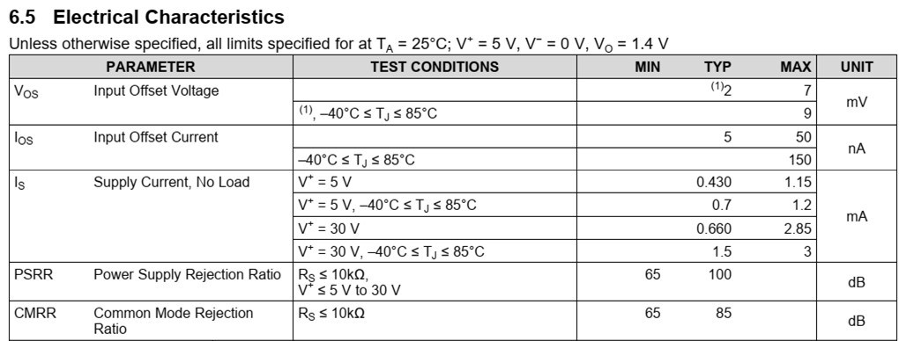

## Course outline {.smaller}

:::: {.columns}
::: {.column width=50%}
- [ ] **วันที่ 1 LabVIEW + myRIO**
    - Automated Test Equipment
    - การเข้าจังหวะและส่งผ่านข้อมูลด้วย LabVIEW 
    - การสร้างสัญญาณทดสอบด้วย NI myRIO
    - **workshop**: การเชื่อมต่อ DUT
- [ ] **วันที่ 2 Instrument drivers**
    - การเชื่อมต่อเครื่องมือวัด
    - ไดรเวอร์ DAQmx และ VISA
    - การวิเคราะห์/บันทึกข้อมูล
    - **workshop**: การเชื่อมต่อและควบคุมเครื่องมือวัด
:::
::: {.column width=50%}
- [ ] **วันที่ 3 NI TestStand**
    - NI TestStand
    - Sequence และ action/test steps
    - การใช้งาน code module
    - **workshop**: การสร้าง sequence ทดสอบ
- [x] **วันที่ 4 Testing in electronics industry**
    - กรณีศึกษาของการทดสอบในอุตสาหกรรม
    - **workshop**: LabVIEW + TestStand for opamp testing
:::
::::

## Workshop outcomes {.smaller}
1. เข้าใจแนวคิดของ specification &rarr; แนวทางการทดสอบ &rarr; เครื่องมือในการทดสอบ
2. เข้าใจ process model และการสร้างรายงานของ NI TestStand
3. สร้าง Test Sequence สำหรับทดสอบ DUT (LM321 opamp)
\
