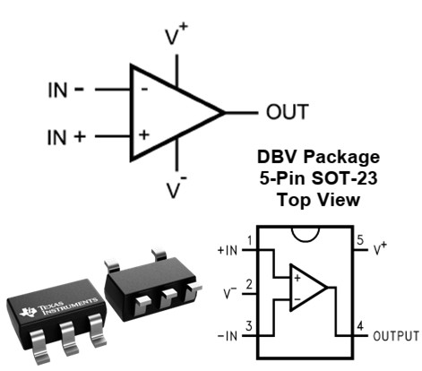
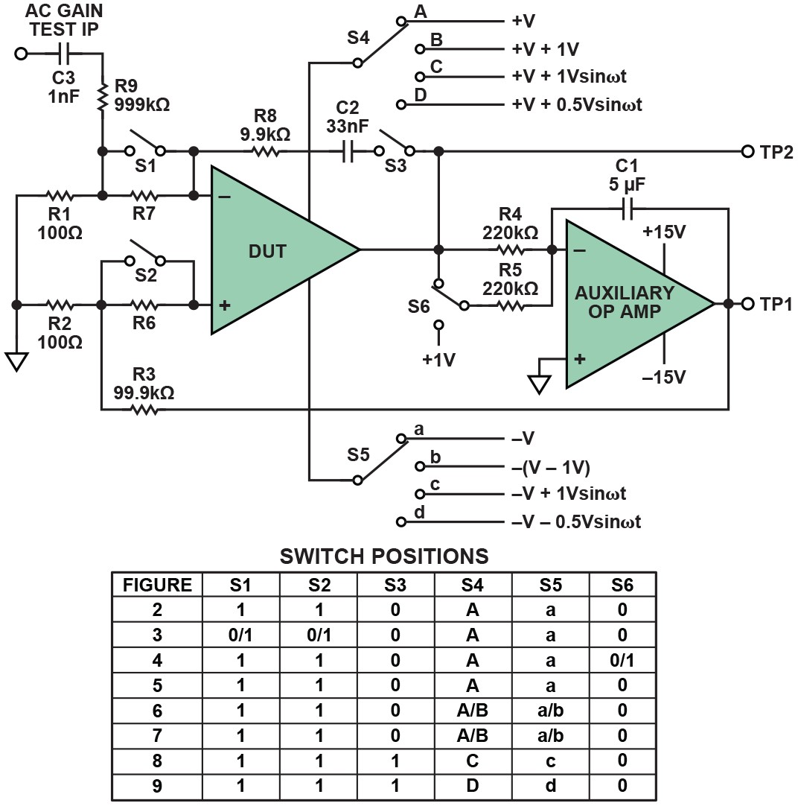
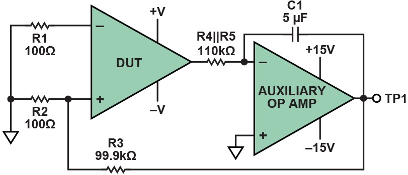
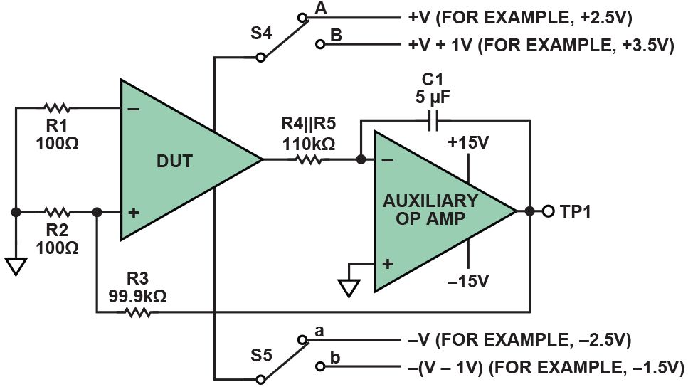
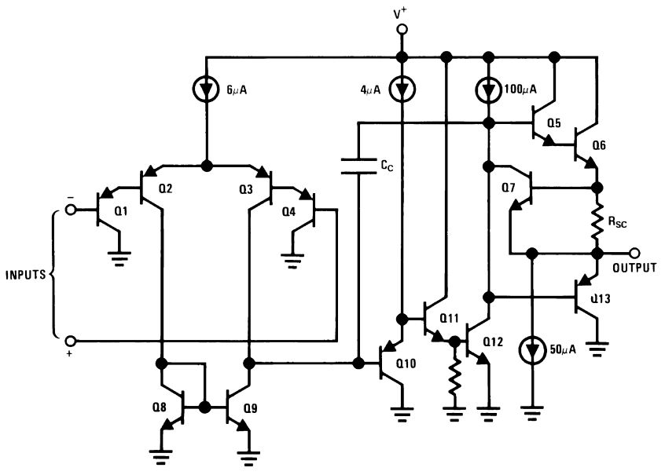
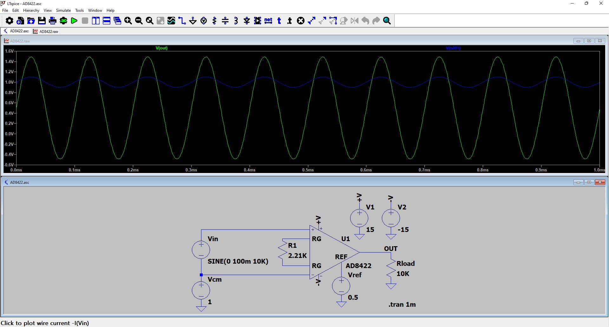

## [LM321](https://www.ti.com/product/LM321) opamp {.smaller}
#### Single, 30-V, 1-MHz operational amplifier
:::: {.columns}
::: {.column width=55%}
\
:::
::: {.column width=45%}
- Supply Voltage Range: 3 V to 32 V
- Gain-Bandwidth Product: 1 MHz
- Slew rate: 0.4 V/µs 
- Supply Current: 430 µA
- Input Bias Current: 45 nA
- SOT-23 package: 2.90 mm x 1.60 mm 
:::
::::

## Opamp DC characteristics {.smaller}
#### Behavior of the op-amp with constant (zero or low frequency) input signals
- Result of mismatches between components inside the op amp

:::: {.columns}
::: {.column width=50%}
1. **Input Offset Voltage ($V_{OS}$)**: <br> input voltage that bring output to 0V (mid of ±V supply)
2. **Input Bias Current ($I_{B+}$ and $I_{B-}$)**: <br> DC currents that flow into inverting/non-inverting inputs
3. **Input Offset Current ($I_{OS}$)**: <br> difference between the two input bias currents
4. **Quiescent Current ($I_Q$)**: <br> Supply current drawn with no load condition
:::
::: {.column width=50%}
5. **Open-Loop Voltage Gain ($A_{OL}$)**: <br> DC differential voltage gain (very high value) without feedback 
6. **Common-Mode Rejection Ratio (CMRR)**: <br> ability to reject signals common to both inputs
7. **Power Supply Rejection Ratio (PSRR)**: <br> ability to reject variations in power supply voltage
8. **Output Voltage Swing ($V_{OH}$ and $V_{OL}$)**: <br> Maximum positive and negative output voltages relative to the rails 
:::
::::

## Opamp AC characteristics {.smaller}
#### Behavior of the op-amp with time-varying (alternating) input signals

:::: {.columns}
::: {.column width=50%}
1. **Gain-Bandwidth Product (GBP)**: <br> product of closed-loop gain and bandwidth in the 20 dB/decade rolloff region
2. **Unity-Gain Bandwidth**: <br> frequency where open-loop gain drops to 1 (0 dB)
3. **Full-power bandwidth ($BW_{FP}$)**: <br> Maximum frequency to deliver a full-amplitude undistorted sine wave
4. **Gain margin ($G_M$) - Phase margin ($\Phi_M$)**: key measures of stability in op-amp feedback systems
:::
::: {.column width=50%}
5. **Slew Rate (SR)**: <br> maximum rate of change (V/µs) of the output voltage
6. **Settling Time ($t_S$)**: <br> time required for the output to be within ab error band after step input
7. **Voltage noise density**: <br> spectral noise voltage per √Hz (nV/√Hz)
8. **Total Harmonic Distortion (THD)**: <br> harmonic distortion introduced by the amplifier.
:::
::::

## [Opamp characterization](https://www.analog.com/en/resources/analog-dialogue/articles/simple-op-amp-measurements.html) {.smaller .scrollable}
**Servo-loop config**: using auxiliary (integrator) op-amp to force the DUT's differential input to zero **&rarr; negate very high DC open-loop gains**

:::: {.columns}
::: {.column width=33%}
2. $V_{OS}$ measurement
3. $I_B$ measurement
4. DC gain measurement
:::
::: {.column width=33%}
5. AC gain measurement
6. DC CMRR measurement
7. DC PSRR measurement
:::
::: {.column width=33%}
8. AC CMRR measurement
9. AC PSRR measurement
:::
::::

\

## Offset voltage measurement {.smaller}
**Offset voltage (VOS)**: small differential voltage that must be applied between the input terminals to make the output zero.

:::: {.columns}
::: {.column width=50%}
- Null feedback with attenuated **TP1** (integrated $V_{OS}$)
:::
::: {.column width=50%}
- Voltage **TP1** เท่ากับ $1000 * V_{OS}$
:::
::::
\

## DC CMRR/PSRR measurement {.smaller}
Ability to reject signals common to both inputs (**CMRR**) and variations in power supply voltage (**PSRR**)

:::: {.columns}
::: {.column width=50%}
- **CMRR**: ±2.5V supply voltage &rarr; +3.5V/-1.5V
:::
::: {.column width=50%}
- **PSRR**: ±2.5V supply voltage &rarr; ±3V
:::
::::
{width=70%}\

## LM321 simulation {.smaller}
:::: {.columns}
::: {.column width=50%}
\
:::
::: {.column width=50%}
#### SPICE simulation

```spice
*LMV321  BICMOS  Low Voltage General Purpose Op Amp
* MODEL FORMAT: PSPICE
* Rev:  11/07/97 -- ABG 
*/////////////////////////////////////////
* Connections       non-inverting input
*                   |  inverting input
*                   |  |  positive power supply 
*                   |  |  |  negative power supply 
*                   |  |  |  |  output 
*                   |  |  |  |  |
.SUBCKT  lMV321     3  2  4  5  6

EOX 120 10 31 32 2.0
RCX 120 121 1K
RDX 121 10 1K
RBX 120 122 1K
GOS 10 57 122 121 1.0

* Input Offset Voltage
.MODEL MRAX RES (TC1=1e-05)
FIN1 18 5 VTEMP 0.833333
FIN2 19 5 VTEMP 1.16667
* Input Bias Currents
CIN1 2 10 1e-12
CIN2 3 10 1e-12

* Slope of Supp. Curr. vs. Supp. Volt.
GPWR 4 5 26 10 0.00013
* Quiescent Supply Current
ETEMP 27 28 32 33 0.286906
RIB 32 33 MRIB 1K
* Temp. Co. of Input Currents
.MODEL MRIB RES (TC1=0.00283713)

* Output Voltage Swing Settings
GSOURCE 74 73 33 34 0.0006
GSINK 72 75 33 34 0.0016
* Output Current Settings
ROO 81 86 8.5
.MODEL DMOD1 D
.MODEL DMOD2 D  (IS=1e-17)
.MODEL NPN1 NPN (BF=100 IS=1e-15)
.MODEL PNP1 PNP (BF=100 IS=1e-15)
.ENDS lmv321
```
:::
::::

## SPICE simulation: [LTspice](https://learn.sparkfun.com/tutorials/introduction-to-operational-amplifiers-with-ltspice/all) {.smaller}
#### Free SPICE simulator software, schematic capture and waveform viewer

\