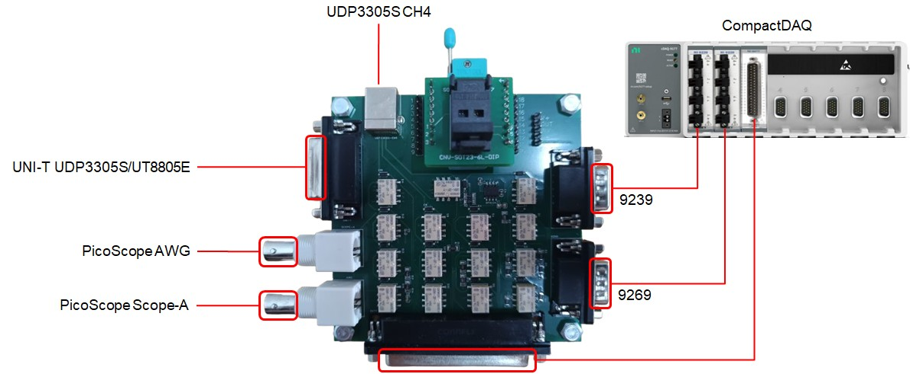
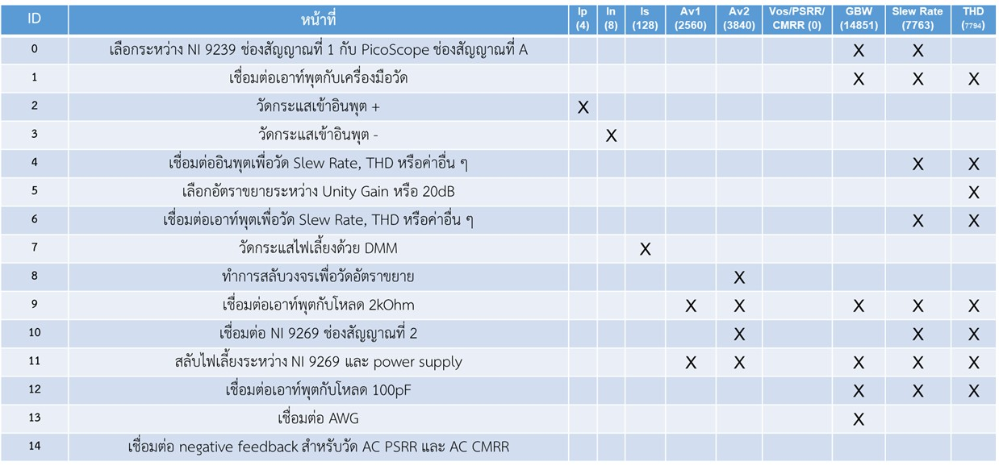
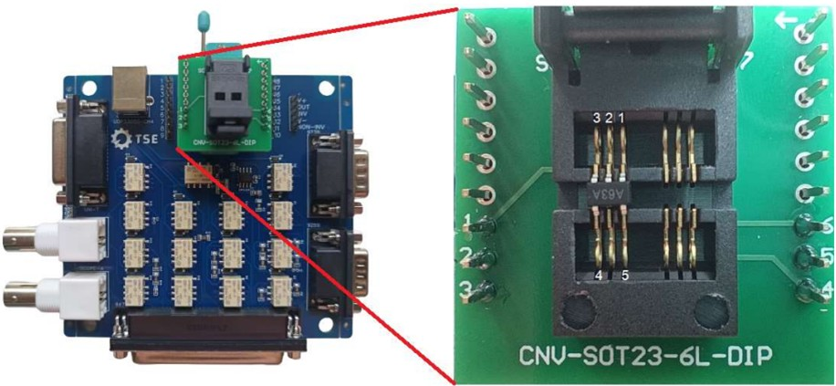
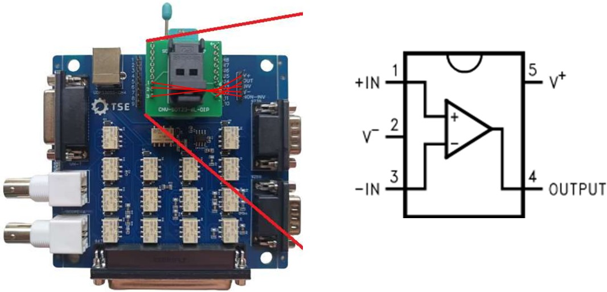
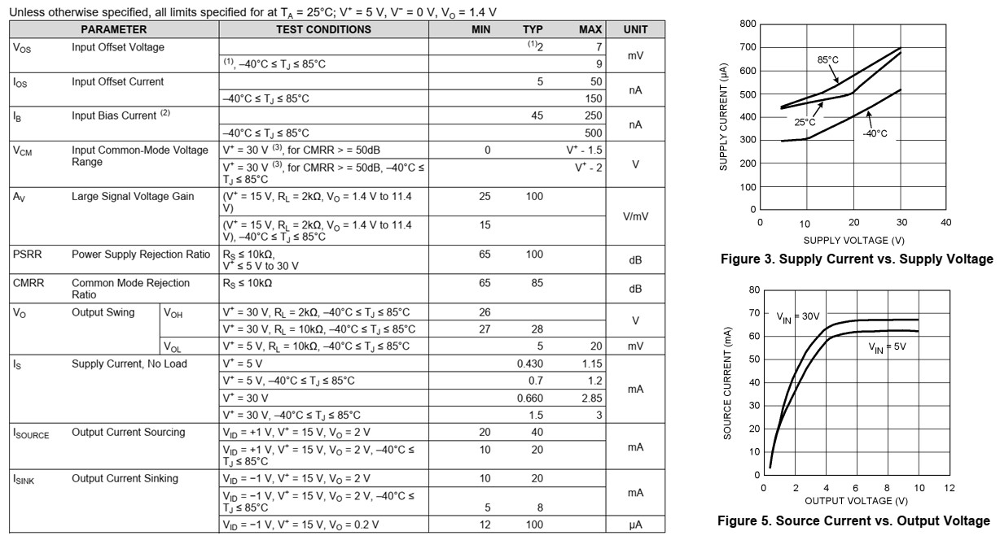

## DIB connectors {.smaller}
:::: {.columns}
::: {.column width=50%}
#### cDAQ-9177 chassis
- NI-9239 วัดแรงดัน
- NI-9269 สร้างแรงดันทดสอบ
- NI-9477 ปิด/เปิด relay แนวสัญญาณ 
:::
::: {.column width=50%}
#### Instruments
- UNI-T UT8805E วัดกระแส
- UNI-T UDP3305S แหล่งจ่ายไฟเลี้ยง
- PicoScope 2206B ทดสอบสัญญาณ > 1 kHz
:::
::::
{width=80%}\

## DIB switch matrix {.smaller}
\

## DUT socket {.smaller}
\

## DUT interface {.smaller}
\

## DUT characteristics: LM321 {.smaller}
\

