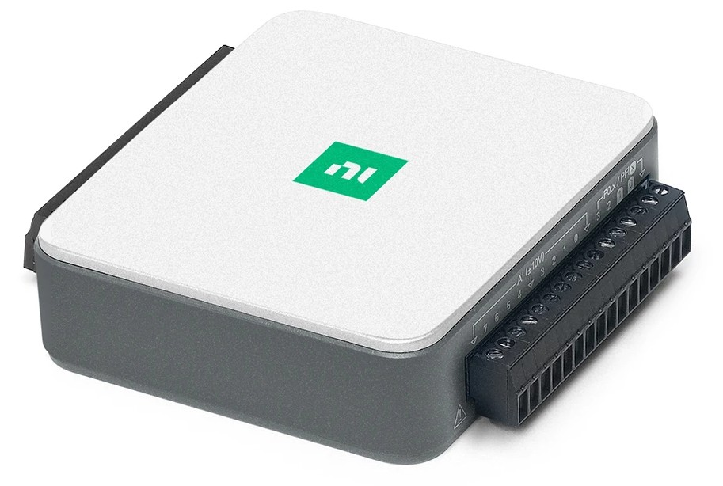
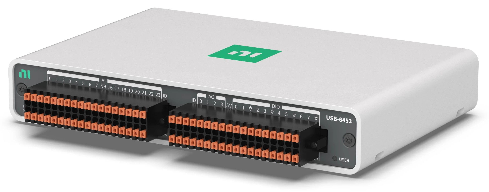
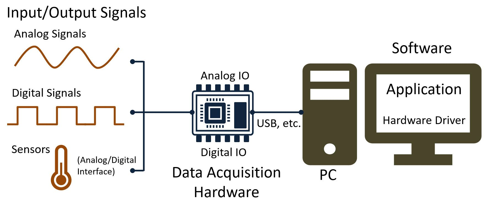
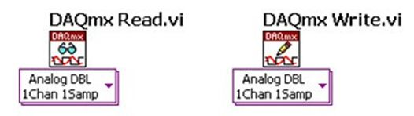
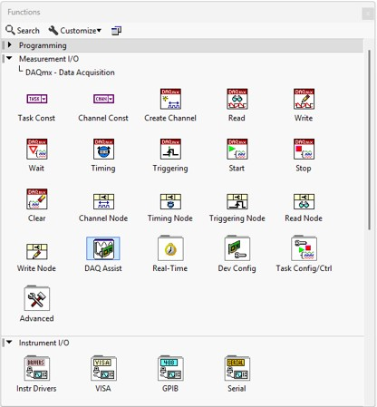
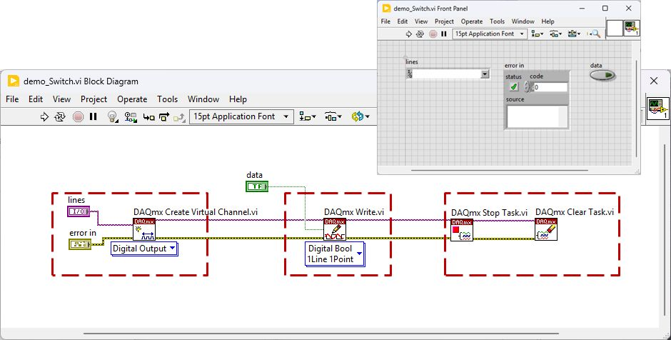
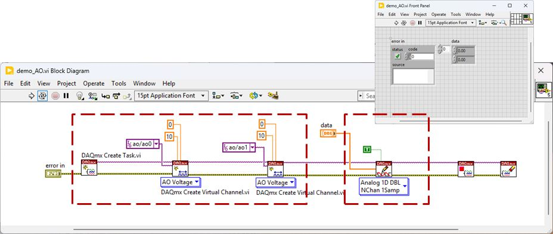
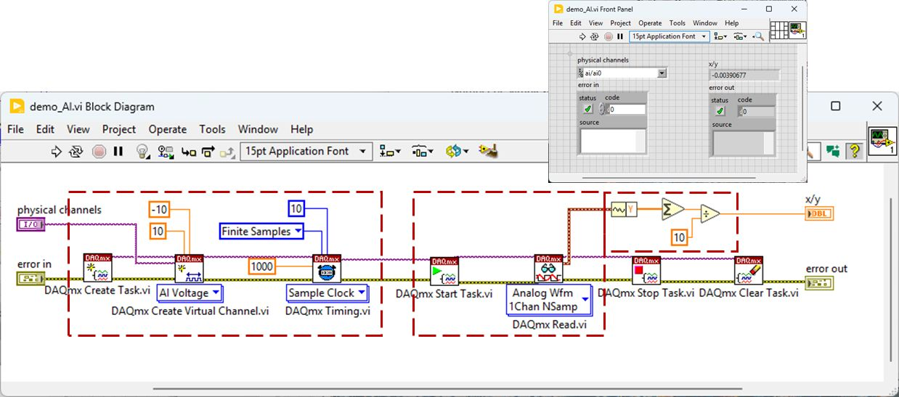

## USB DAQ {.smaller}
Multifunction I/O devices for data acquisition and control, combining flexible I/O capabilities for industry applications. 

:::: {.columns}
::: {.column width=50%}
#### NI USB-6001: low cost DAQ
- 4 differential/8 single-ended ±10V AIs 
    - 14-bit ADC, aggregated 20 kS/s
- 2 single-ended ±10V AOs
    - 14-bit DAC, simultaneous 5 kS/s/ch
- 13 digital lines

{width=55%}\
:::
::: {.column width=50%}
#### NI USB-6453: high performance DAQ
- 16 differential/32 single-ended ±10V AIs 
    - 20-bit ADC, 1MS/s/ch
- 4 single-ended ±10V AOs
    - 16-bit DAC, simultaneous 250 kS/s/ch
- 16 digital lines

{width=75%}\
:::
::::

## NI-DAQmx &lrarr; DAQ hardware {.smaller}
**Data acquisition (DAQ)** is the process of measuring an electrical or physical phenomenon, such as voltage, current, temperature, pressure, or sound.

:::: {.columns}
::: {.column width=70%}
\
:::
::: {.column width=30%}
#### DAQmx API
\

- On-demand
- N-points + sampling rate
:::
::::

## [DAQmx concepts](https://www.ni.com/docs/en-US/bundle/ni-daqmx/page/keyconcepts.html) {.smaller}

:::: {.columns}
::: {.column width=50%}
- **Channel**: ซอฟต์แวร์ที่เป็นตัวแทนของ physical channel และข้อมูลที่เกี่ยวข้อง (range, terminal config, scaling)
    - Analog Input channels (ai*)
    - Analog Output channels (ao*)
    - Counter I/O channels (ctr*)
    - Digital I/O channels (port\*/line\*)
    - Power channels 
- **Task**: รายการของ channels และข้อมูลที่เกี่ยวข้อง (timing, trigger)
:::
::: {.column width=50%}
#### Channel properties
- **Range**: ย่านของค่าที่วัด/สร้าง เช่น ±10 V
- **Terminal config**: วิธีต่อ เช่น singled-end
- **Scaling**: สมการแปลงค่า

#### Task properties
- **Timing**: คาบเวลา/ความถี่ในการทำงาน
- **Trigger**: เงื่อนไขในการทำงาน
:::
::::

## Programming DAQmx hardware {.smaller}

:::: {.columns}
::: {.column width=40%}
\
:::
::: {.column width=60%}
- **NI MAX**:
    - Create Task 

- **Express VI**:
    - DAQ Assistant

- **Low-level API**:
    - DAQmx Create Virtual Channel
    - DAQmx Timing / DAQmx Trigger
    - DAQmx Start Task / DAQmx Stop Task / DAQmx Clear Task
    - DAQmx Read / DAQmx Write
:::
::::

## cDAQ tutorial: NI-9477 {.smaller}
#### สร้าง VI สำหรับควบคุมสวิทช์ S7

- ยุบเป็น SubVI: `switch_init`, `switch_ctrl` และ `daqmx_stop`

\

## cDAQ tutorial: NI-9269 {.smaller}
#### สร้าง VI สำหรับควบคุมไฟเลี้ยง DUT opamp

- ยุบเป็น SubVI: `ao_init` และ `ao_update`

\

## cDAQ tutorial: NI-9239 {.smaller}
#### สร้าง VI สำหรับอ่านแรงดัน $V_{OS}$

- ยุบเป็น SubVI: `ai_init` และ `ai_measure`

\
