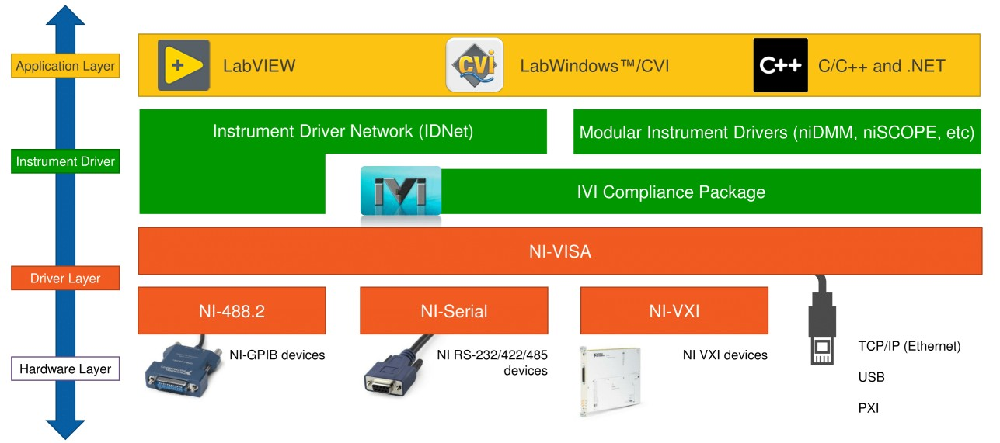
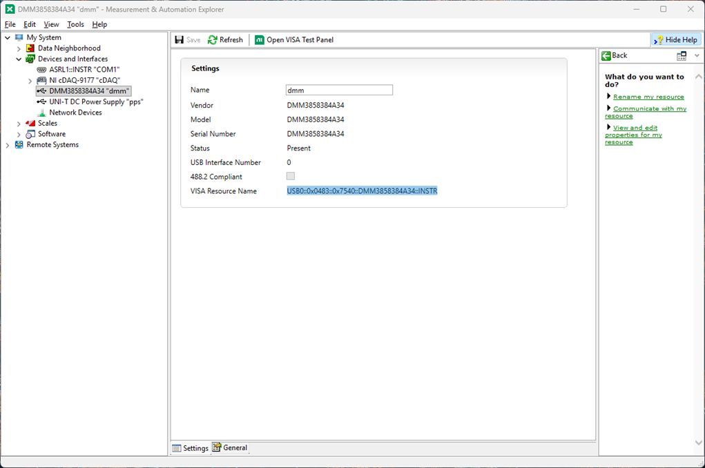
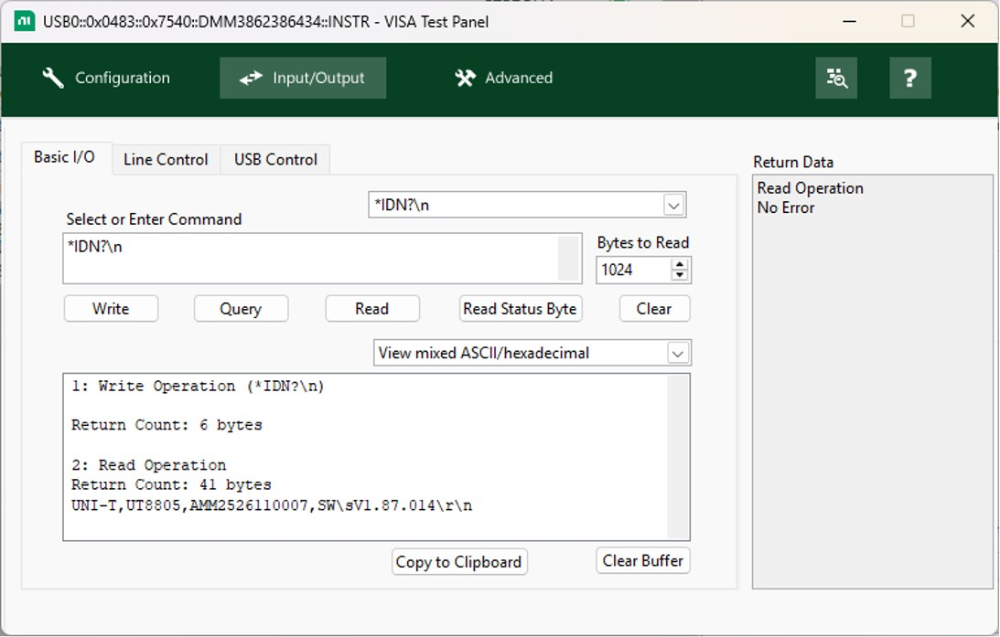
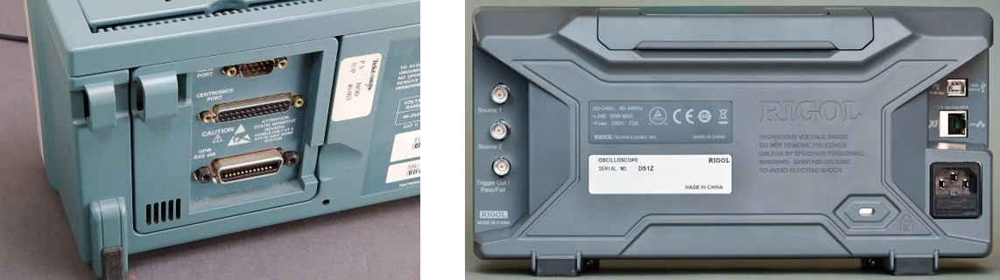
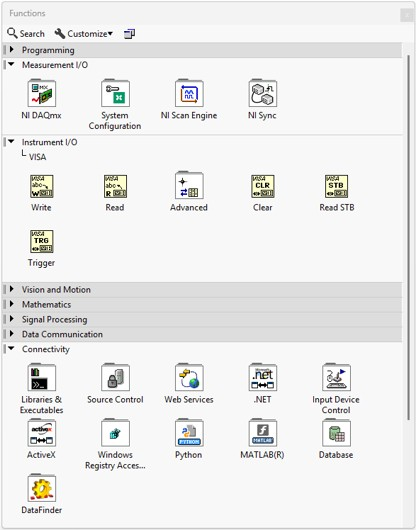
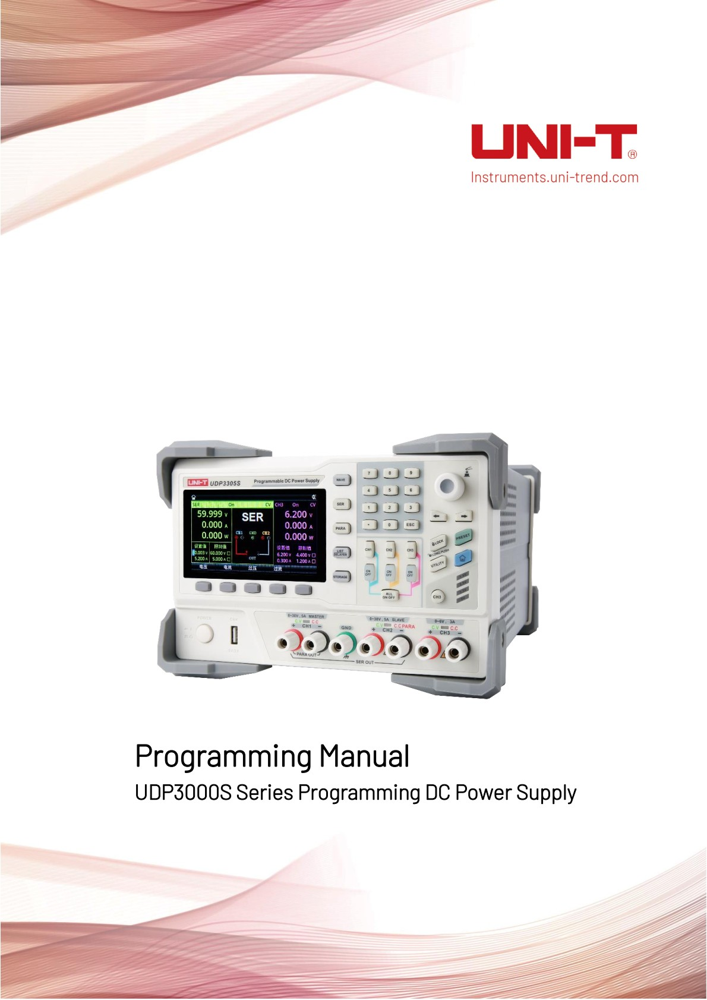
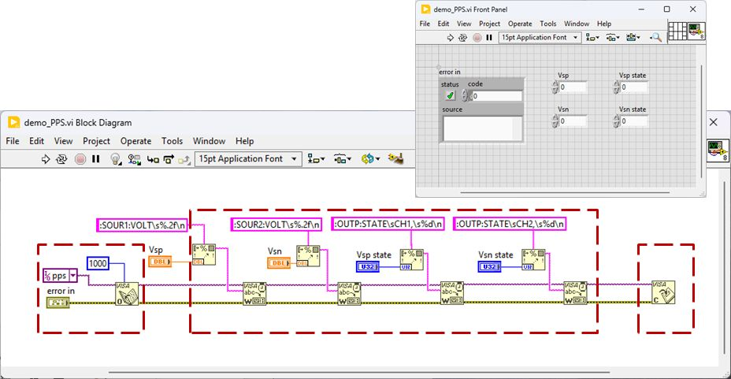
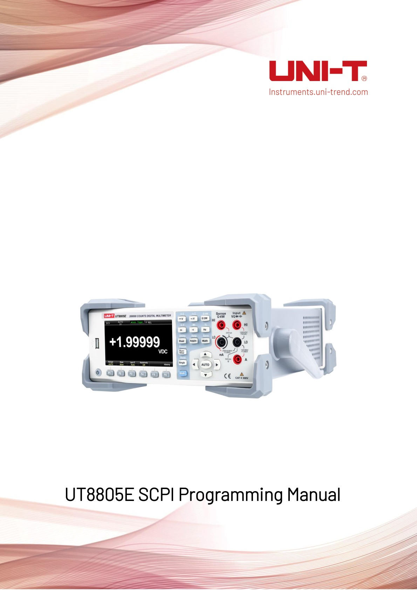
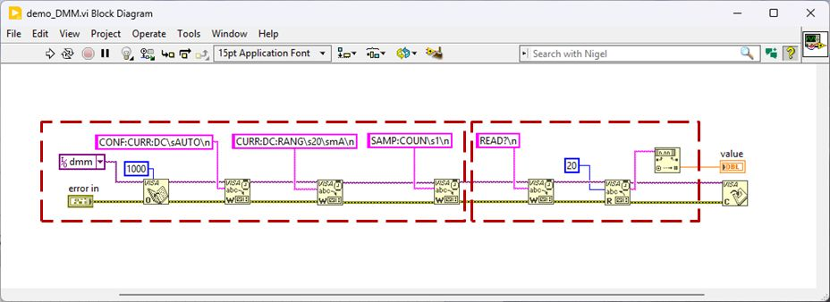

## NI-VISA &lrarr; instrument {.smaller}
Instrument driver that provides a **software interface** for configuring, programming, and troubleshooting **instrumentation systems** across multiple **communication buses**

\

## NI MAX {.smaller}

:::: {.columns}
::: {.column width=70%}
\
:::
::: {.column width=30%}
#### Devices and Interfaces

- อุปกรณ์และอินเทอร์เฟซที่ระบบมองเห็น: resource name
- ชื่อแทน (Alias) ของ resource name

#### Test Panel

- UI สำหรับทดสอบการสื่อสาร

:::
::::

## NI MAX &rarr; VISA Test Panel {.smaller}

:::: {.columns}
::: {.column width=60%}
\
:::
::: {.column width=40%}
#### VISA Test Panel
- **Write**: ส่งคำสั่ง
- **Query**: ส่ง query command แล้วรับคำตอบ
- **Read**: อ่านข้อมูลใน buffer ของเครื่องมือวัด

#### SCPI commands: จบด้วย `\n`

- **\*IDN?** ขอข้อมูลของเครื่องมือ
- **\*RST** รีเซ็ตการทำงาน
:::
::::

## SCPI protocol {.smaller}
[**Standard Commands for Programmable Instruments**](https://en.wikipedia.org/wiki/Standard_Commands_for_Programmable_Instruments) is a standard for controlling programmable test and measurement devices

{width=75%}\

- ASCII strings sent over physical layer (GPIB, RS232C, USB, Ethernet)
    - Commands as tree structure separated with **:**
    - Support Abbreviating (capital chars) and Concatenating (**;**)
    - Query commands end with **?**
- Example: `MEASure:VOLTage:DC?;:MEAS:CURR:AC?`

## SCPI cmd &lrarr; NI-VISA &lrarr; instrument {.smaller}
:::: {.columns}
::: {.column width=40%}
\
:::
::: {.column width=60%}
- อ้างอิงเครื่องมือวัดด้วย **VISA reference** 
    - ตรวจสอบ **interface/ชื่อ** จาก NI MAX
- ลำดับการโปรแกรมเครื่องมือวัด
    1. ใช้ **VISA Open** เปิดการเชื่อมต่อ
    2. วนรอบตั้งค่าด้วย **VISA Write** และอ่านค่าด้วย **VISA Read**
        - ตั้งค่า string เป็น **`'\'` Codes Display**
        - ใช้ **Format Into String** และ **Fract/Exp String to Number** เพื่อแปลง
    3. ใช้ **VISA Close** ปิดการเชื่อมต่อ
:::
::::

## Programming [UDP3305S](https://uni-trendus.com/products/udp3305s-e) {.smaller}
:::: {.columns}
::: {.column width=40%}
\
:::
::: {.column width=60%}
#### ลำดับของคำสั่งสร้างแรงดันไฟเลี้ยง
1. `:SOURce:Mode {NORMal|SER|PARA}`
    - `:SOURce:Mode NORMal` ตั้งโหมดสร้างแรงดันปกติ
2. `[:SOURce#]:VOLTage[:LEVel][:IMMediate][:AMPLitude]`
    - `:SOURce1:VOLTage 2.0` ตั้ง CH1 ให้สร้างแรงดัน 2.0 โวลต์
3. `:OUTPut[:STATe] [CH1|CH2|CH3|SER|PARA|ALL,] {0|1|OFF|ON}`
    - `:OUTPut:STATe CH1, ON` เปิด CH1 จ่ายเอาต์พุต
:::
::::

## UDP3305S SCPI tutorial {.smaller}
#### สร้าง VI ควบคุมไฟเลี้ยง AUX opamp

- ยุบเป็น SubVI: `pps_connect`, `pps_ctrl` และ `visa_close`

\

## Programming [UT8805E](https://uni-trendus.com/products/UT8805E) {.smaller .scrollable}
:::: {.columns}
::: {.column width=40%}
\
:::
::: {.column width=60%}
#### การอ่านแรงดันไฟฟ้าทันที
1. `MEASure[:VOLTage]:{AC|DC}? [{<range>|AUTO|MIN|MAX|DEF}]`
    - `MEAS:VOLT:AC? 20` วัดแรงดันไฟฟ้า AC ด้วยย่านการวัด 20 โวลต์

#### การอ่านแรงดันไฟฟ้าแบบหลายค่า
1. `CONFigure[:VOLTage]:{AC|DC}
[{<range>|AUTO|MIN|MAX|DEF}]`
    - `CONF:VOLT:AC 20` ตั้งโหมดวัดแรงดันไฟฟ้า AC ด้วยย่านการวัด 20 โวลต์
2. `SAMPle:COUNt {<count>|MIN|MAX|DEF}SAMPle:COUNt? [{MIN|MAX|DEF}]`
    - `SAMP:COUN 2` กำหนดอ่าน 2 ค่า 
3. `READ?`
    - `READ?` อ่านค่าแรงดัน
:::
::::

## UT8805E SCPI tutorial {.smaller}
#### สร้าง VI เลือกโหมดวัดกระแสและอ่านค่า

- ยุบเป็น SubVI: `dmm_connect` และ `dmm_read`

\

## [PyVISA](https://www.pyvisa.com/docs) quick demo {.smaller}
Python package that provides bindings to the Virtual Instrument Software Architecture (VISA) library

:::: {.columns}
::: {.column width=40%}
#### Procedure
1. Install Python
    - Use `pip install pyvisa` to install PyVISA library
2. Check instrument's **resource name** from NI MAX
:::
::: {.column width=60%}
#### Python code

```python
import pyvisa
rm = pyvisa.ResourceManager()
print(rm.list_resources())
pps = rm.open_resource('USB0::0xFFFF::0xFFFF::FFFFFF::INSTR')
volt = pps.query(':SOUR1:VOLT?\n')
print(volt)
```
:::
::::