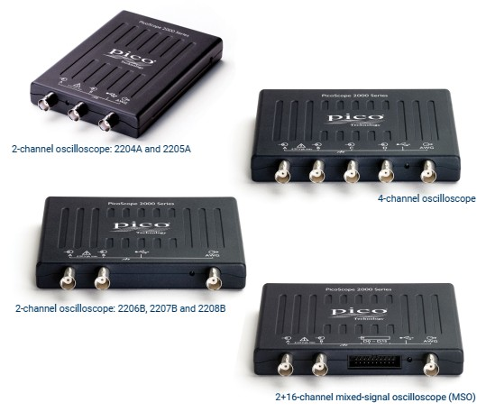
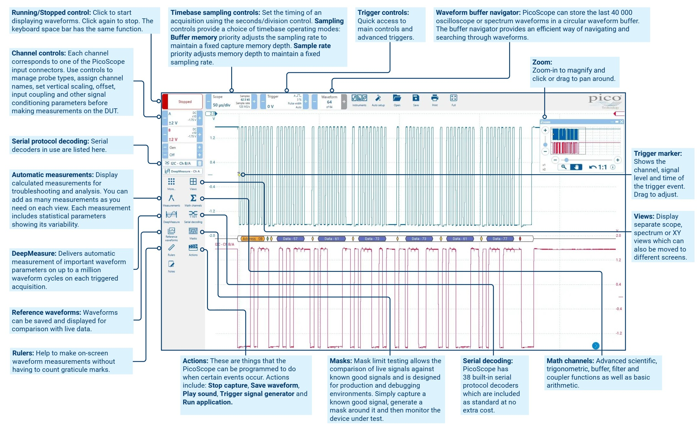
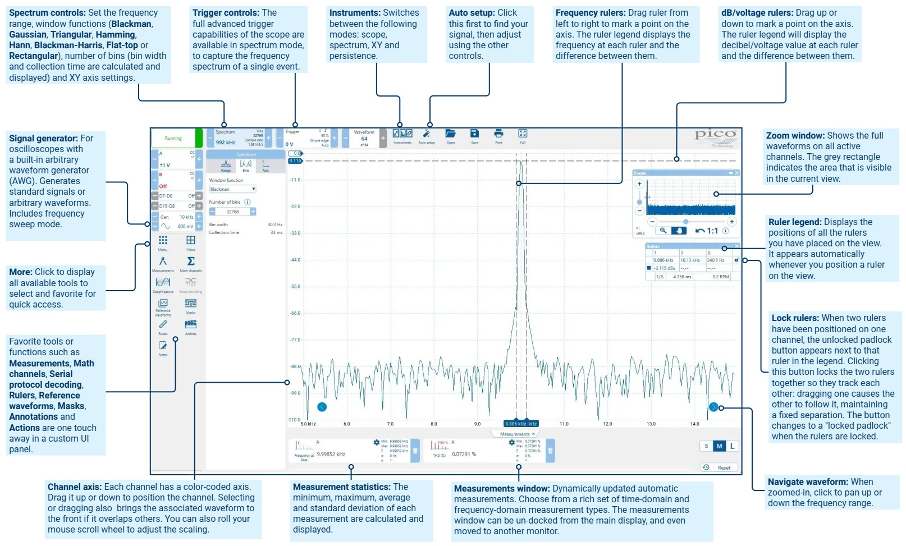
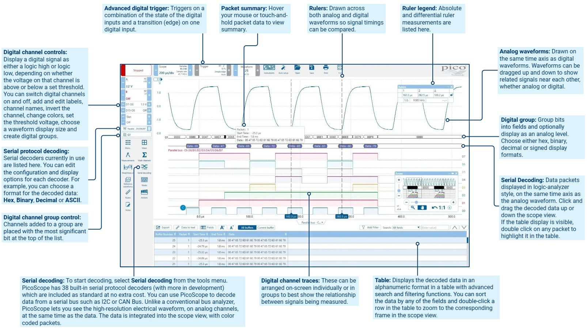
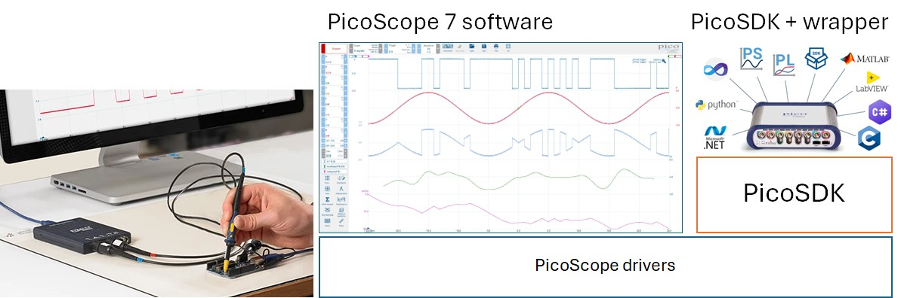
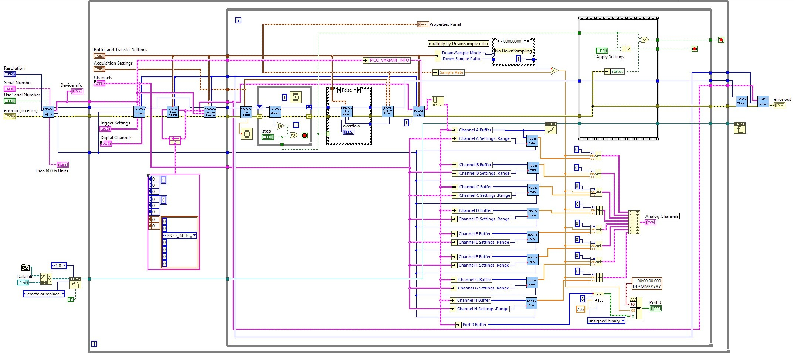

## PicoScope 2206B {.smaller}
:::: {.columns}
::: {.column width=47%}
\
:::
::: {.column width=53%}
#### Specifications
- 50 MHz bandwidth, 8-bit ADC, 32 MB capture memory
- AWG 1 MHz bandwidth
- Input range: ±20 mV, ±50 mV,..., ±10 V, ±20 V
- Timebase: 2 ns/div, ..., 5000 s/div
- Sampling rate: 500 MS/s
    - 9.6 MS/s (USB streaming)
    - 31 MS/s (PicoSDK)
- Triggers: edge, pulse width, rise/fall time, interval, ...
:::
::::

## PicoScope 7 {.smaller}
\

## PicoScope 7 {.smaller}
\

## PicoScope 7 {.smaller}
\

## Proprietary SDKs {.smaller}
[PicoSDK](https://www.picotech.com/library/our-oscilloscope-software-development-kit-sdk) is the driver to access PicoScope hardware functionalities, including ADC block and streaming capture and the built-in function generator.
- LabVIEW Driver is the .DLL wrapper for PicoSDK

\

## PicoSDK wrapper for LabVIEW {.smaller}
\

## Programming [PicoScope 2206B](https://github.com/picotech/picosdk-ni-labview-examples/tree/master/ps2000a) {.smaller}
:::: {.columns}
::: {.column width=50%}
#### Sampling mode
- **Block mode**: สุ่มวัดด้วย MAX sampling rate/{1,2,4,...} บันทึกในหน่วยความจำจนเต็ม แล้วรอโอนย้ายไปคอมพิวเตอร์
- **Streaming mode**: สุ่มวัดแล้วโอนย้ายไปคอมพิวเตอร์
    - **Compatible streaming**: sampling rate ต่ำ, ไม่รองรับ trigger
    - **Fast streaming**: sampling rate สูง, รองรับ trigger 
- **ETS (Equivalent Time Sampling) mode**: หลังจาก trigger สุ่มวัดสัญญาณหลายรอบ บันทึกในหน่วยความจำจนเต็ม แล้วรอโอนย้ายไปคอมพิวเตอร์
:::
::: {.column width=50%}
#### ลำดับ PicoSDK: block mode
1. **PicoScope2000aOpen.vi** เปิดใช้งาน
2. **PicoScope2000aSetDataBuffers.vi** กำหนดหน่วยความจำข้อมูล
3. **PicoScope2000aSettings.vi** กำหนด channel, timebase, trigger
4. เข้าวงรอบ
    1. **PicoScope2000aRunBlock.vi** เริ่มสุ่มวัด
    2. **PicoScope2000aIsReady.vi** เช็คสถานะ
    3. **PicoScope2000aGetValues.vi** นำเข้าข้อมูล
5. **PicoScope2000aStop.vi** หยุดการสุ่มวัด
6. **PicoScope2000aClose.vi** ปิดการเชื่อมต่อ
:::
::::
