## Product reqs &rarr; Test implementation {.smaller}

:::: {.columns}
::: {.column width=65%}
| Product / Manufacturing | Test Engineer |
| --- | ---- |
| Product specification | Requirement analysis |
| Test specification | Test plan |
| Fixture | Fixture design |
| Test program | Software development: **LabVIEW** / **TestStand**  |
| Test platform  | Fixture + instrumentation integration |
| DUT measurement | Execute test & validate results |
| PASS / FAIL / Bin | Report & database |
:::
::: {.column width=35%}
#### Fixture ex: test socket

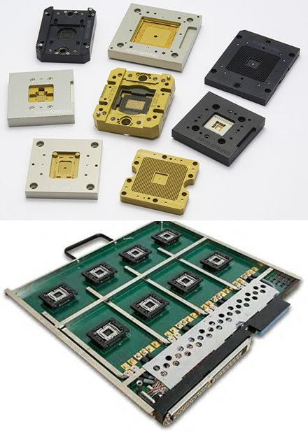\
:::
::::

## Why LabVIEW? {.smaller}

:::: {.columns}
::: {.column width=50%}
#### Hardware interfacing
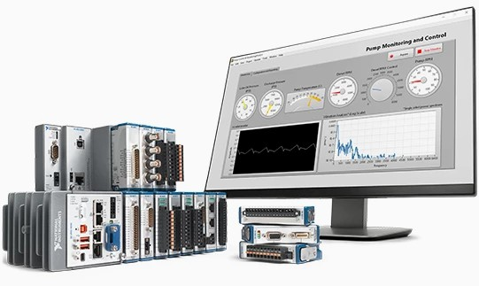\
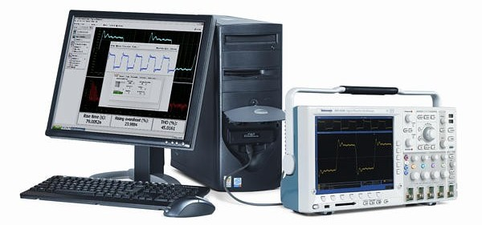\

:::
::: {.column width=50%}
#### Virtual Instrument &rarr; UI
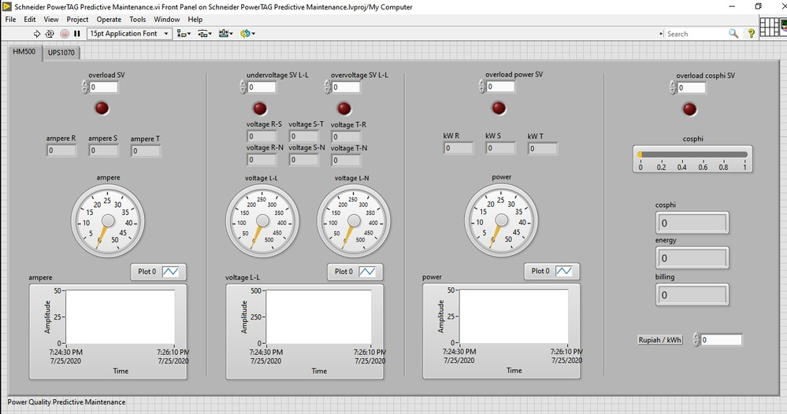\
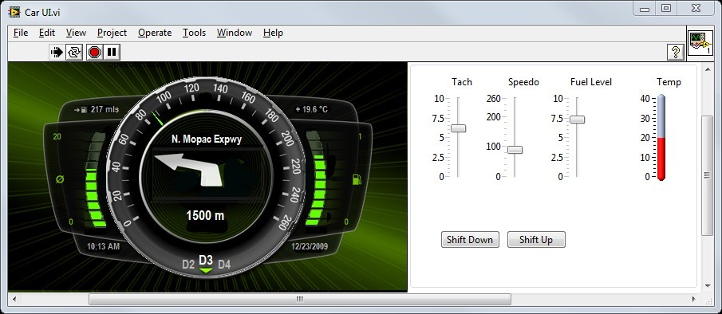\
:::
::::

## Tester = LabVIEW + instr. + fixture {.smaller}
:::: {.columns}
::: {.column width=32%}
#### NI-DAQmx
- NI instrument driver that controls DAQ systems
- Library of VIs, functions, classes, attributes, and properties to configure, control, stream data

{width=75%}\
{width=75%}\
:::
::: {.column width=32%}
#### NI-VISA
- Virtual Instrument Software Architecture 
- Instrument driver and software API used to configure, program, and control instruments
- Interfaces: USB, Ethernet, GPIB, Serial.

\
:::
::: {.column width=32%}
#### NI-PXI
- HW/SW platform built for test automation
- Synchronize across multiple modules or chassis
- PXI embedded controller = PC inside PXI

\
:::
::::

## NI MAX {.smaller}
**Measurement & Automation Explorer** ใช้ตั้งค่าและตรวจสอบเครื่องมือวัด/DAQ/PXI
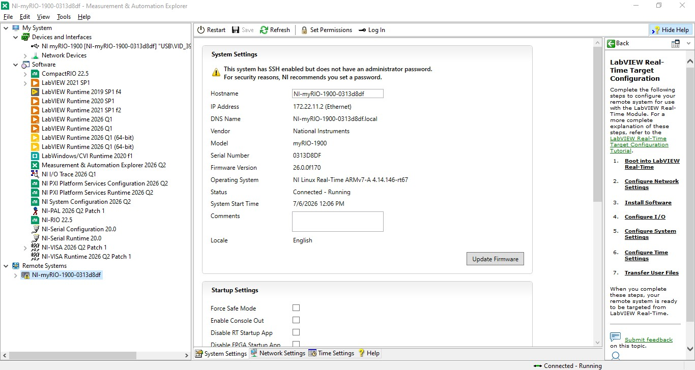\

## LabVIEW {.smaller}
:::: {.columns}
::: {.column width=50%}
#### Front panel: ส่วนหน้าจอ
- ประกอบด้วย Controls (รับคำสั่ง/ข้อมูล) และ Indicators (แสดงผล)
- ทำงานแบบ interactive

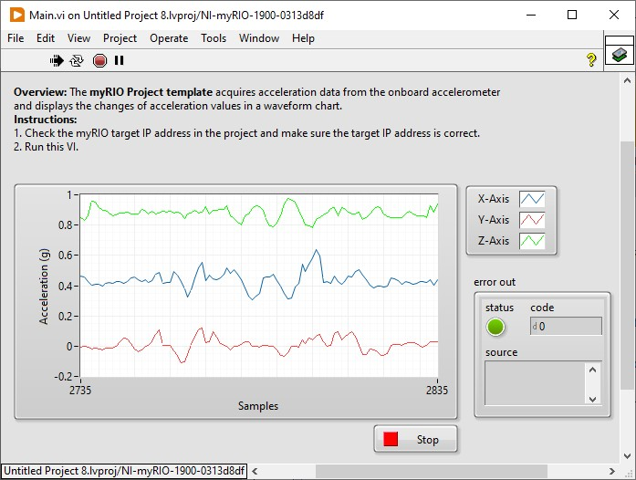\
:::
::: {.column width=50%}
#### Block diagram: ส่วนโค้ด
- GUI style &rarr; drag & drop แล้ว connect
- Execution &rarr; dataflow programming
    - (รอ) ข้อมูลเข้า &rarr; ประมวลผลและส่งต่อ 
    - ทำงานแบบ **parallel** loop ได้
- แนะนำไล่จาก **ซ้าย** ไป **ขวา** 

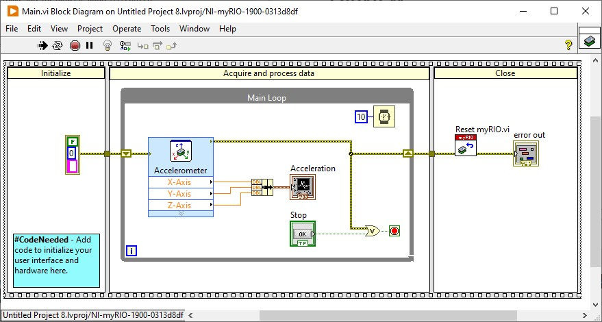\
:::
::::

## LabVIEW quick tutorial #1 {.smaller}
#### ลองสร้าง VI พล็อตกราฟของค่า random

- Delay loop + array + waveform chart/graph
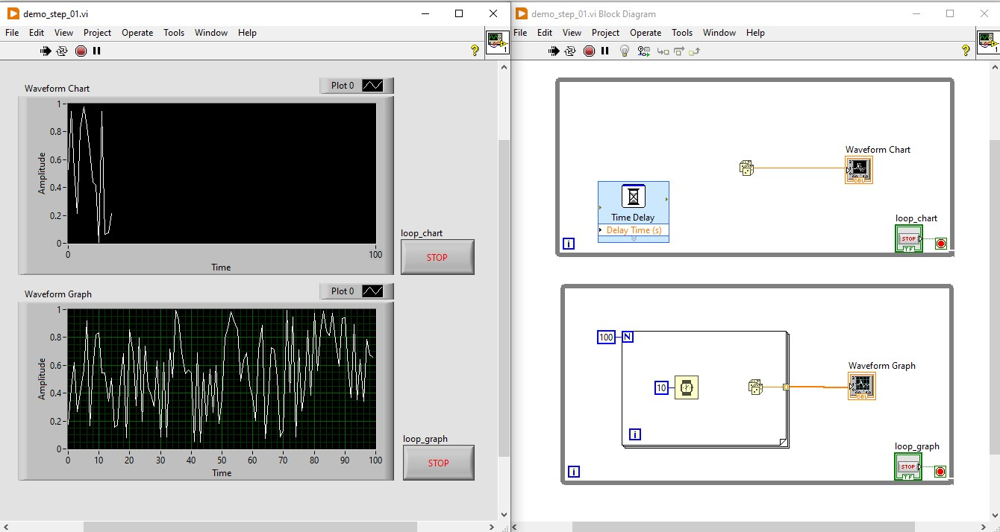\

## LabVIEW terminology {.smaller}
:::: {.columns}
::: {.column width=50%}
- **Data types:**
    - **Numeric**: สีส้ม (DBL/SGL), สีน้ำเงิน (INT/UINT/enum)
    - **Boolean**: สีเขียว
    - **Array**: เส้นหนา (1D), เส้นคู่ (2D)
    - **String** และ **Cluster**: สีชมพู
- **Control flow:**
    - **While**: ทำงานตามเงื่อนไข
    - **For**:  N รอบ หรือตามจำนวนข้อมูล
    - **Case structure**: if-else, switch-case
- **SubVI:**
    - **Connector Pane**: Required, Recommend, Optional
:::
::: {.column width=50%}
- **Timing:**
    - **Loop + delay**: ง่ายแต่ไม่แม่น 
    - **Timed loop**: ความแม่นยำ/ความละเอียดทางเวลา
    - **Block waiting**: รอข้อมูลจาก HW
- **Data passing:**
    - **Shift register**: ส่งข้อมูลข้าม loop
    - **Local variable**: แชร์การเข้าถึง
    - กลุ่ม synchronized function
- **UI programming:**
    - **Event structure**: callback ของ UI event
    - **Property node**: อัพเดท UI
:::
::::

## Debugging LabVIEW {.smaller}
:::: {.columns}
::: {.column width=65%}
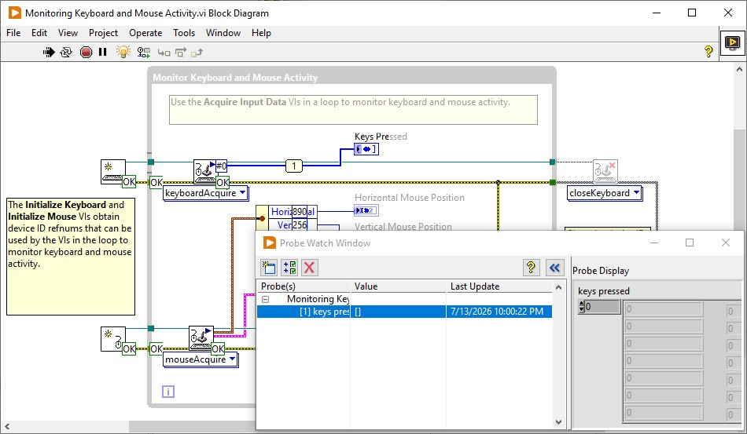\
:::
::: {.column width=35%}
#### Highlight Execution
- แสดงลำดับการไหลของ data ผ่าน node ต่างๆ

#### Probe
- แสดงข้อมูลส่งผ่านระหว่าง node

#### Breakpoint / Step
- หยุดการทำงานเมื่อ node มีข้อมูลครบ
- บังคับให้ทำงานทีละ node
:::
::::

## LabVIEW quick tutorial #2 {.smaller}

#### ลองสร้าง N-point moving average filter

- Shift register + bundle cluster + sub VI

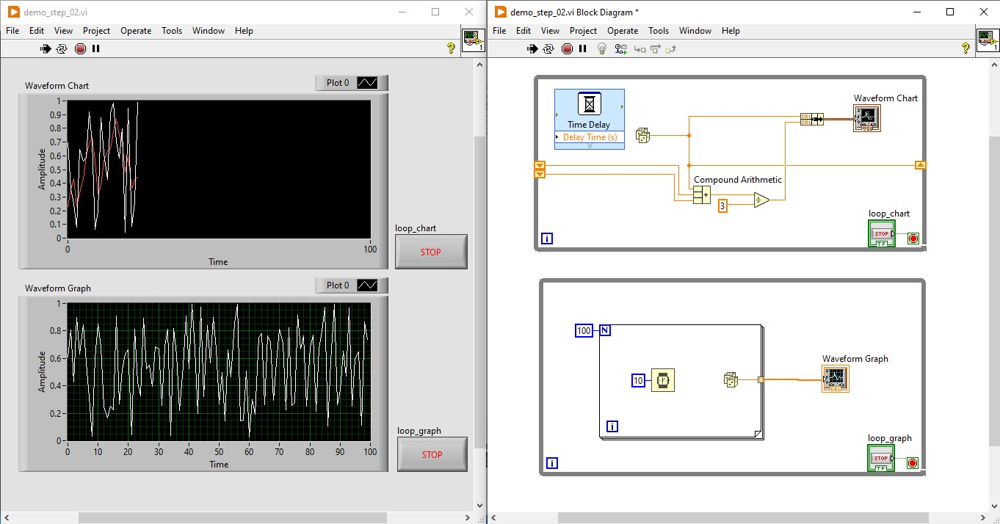\

## Processing in LabVIEW {.smaller}

:::: {.columns}
::: {.column width=50%}
#### Mathematics
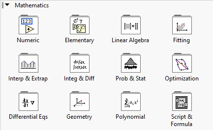\
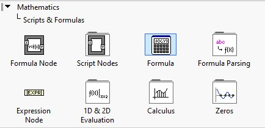\
:::
::: {.column width=50%}
#### Signal processing
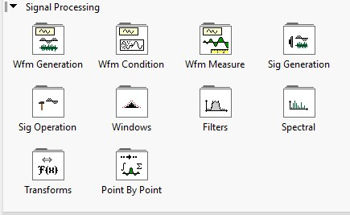\
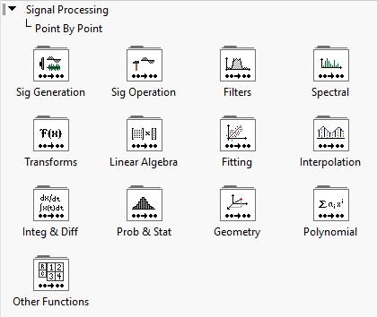\
:::
::::

## Processing in LabVIEW {.smaller}

:::: {.columns}
::: {.column width=50%}
#### Data/status operations
- Local/Global/Shared variables
- Feedback node
- Property nodes
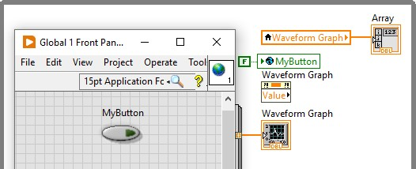\

#### File operations
- Spreadsheet files
- TDMS files
:::
::: {.column width=50%}
#### Programmable UI
- **Event structure**: executed when user did something with UI
- **Property node**: method to access internal status/data of UI components

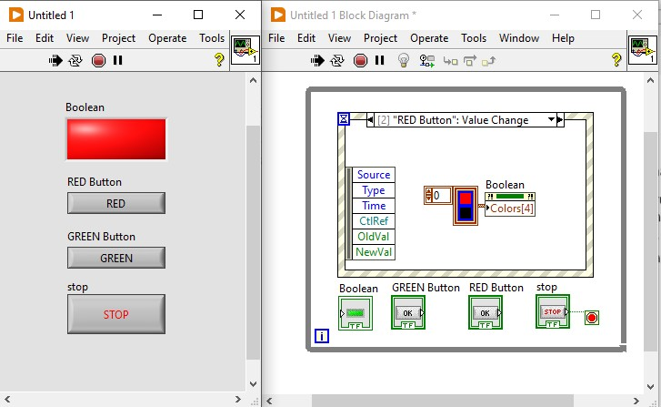\
:::
::::

## LabVIEW synchronization {.smaller}
:::: {.columns}
::: {.column width=50%}
- **Notifier**: send event &rarr; wait on event
    - ใช้กลไก broadcast (1-to-many)
- **Queue**: enqueue msg &rarr; dequeue
    - ทำงานแบบ FIFO
:::
::: {.column width=50%}
#### Resource protection
- **Semaphore**: acquire &larr; wait for release

#### Wait for every task
- **Rendezvous**: wait on &rarr; continue together

:::
::::
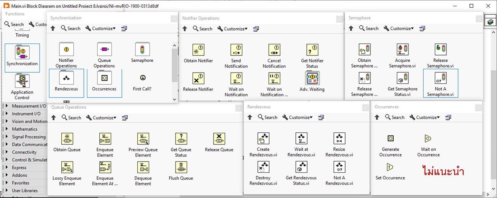{width=80%}\

## LabVIEW quick tutorial #3 {.smaller}
#### ลองสร้าง UI loop สำหรับคุมจังหวะของ loop

- Event Structure + notifier + property node

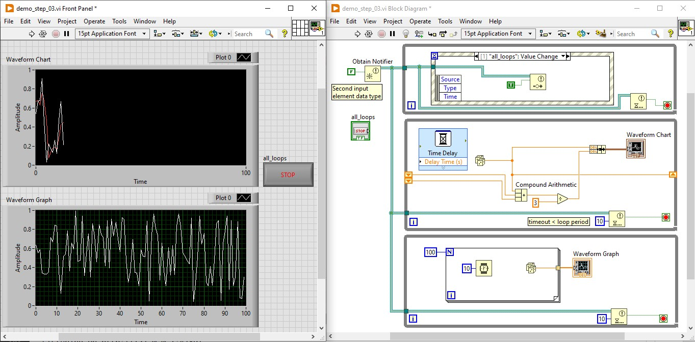\

## Pattern: [state machine](https://www.ni.com/en/support/documentation/supplemental/16/simple-state-machine-template-documentation.html) {.smaller}
Programming architecture that allows dynamic flow to **states** depending on values from previous states or user inputs

- **Enum** หรือ **String** เป็น state &rarr; shift register คงค่าไปรอบถัดไป
- **Case structure** อยู่ใน **while loop**

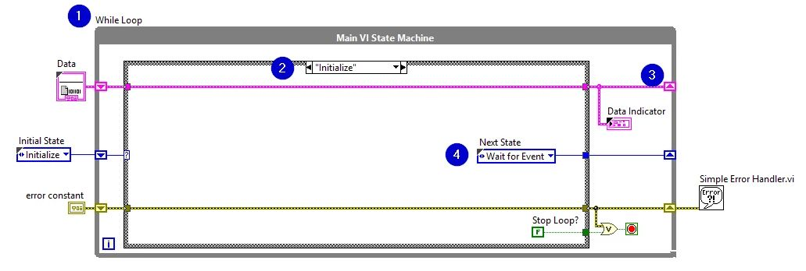\

## Pattern: [producer/consumer](https://www.ni.com/en/support/documentation/supplemental/21/producer-consumer-architecture-in-labview0.html) {.smaller}
Data sharing architecture between multiple loops running at different rates. 

:::: {.columns}
::: {.column width=40%}
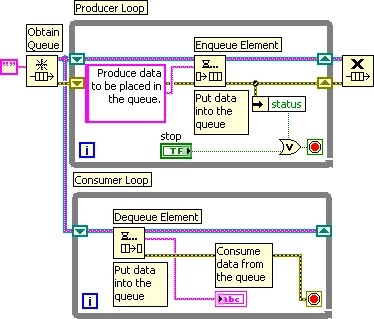\
:::
::: {.column width=60%}
- Queue
- Loops with similar/different timing
    - Data producing loops: **enqueue**
    - Data consuming loops: **dequeue**
:::
::::

## Pattern: [Actor Framework](https://www.linkedin.com/pulse/masterclass-labview-architectures-mastering-actor-framework-zhang-mqvvf/) {.smaller}
:::: {.columns}
::: {.column width=30%}
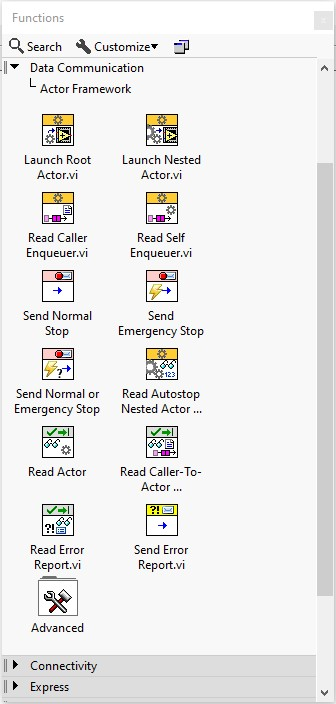\
:::
::: {.column width=70%}
Set of **reusable** classes that provide common state and message handling functions for **concurrent** operations.

- **Actor** class: by-value object with encapsulated state
    - Binded with queue as tree architecture
- **Message** class: 
    - Inherited **Do.vi**

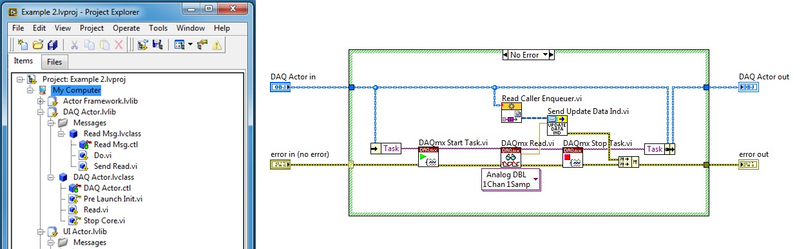\
:::
::::