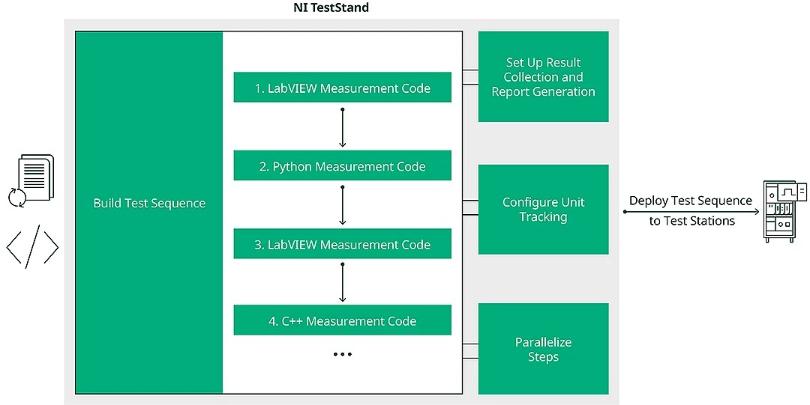
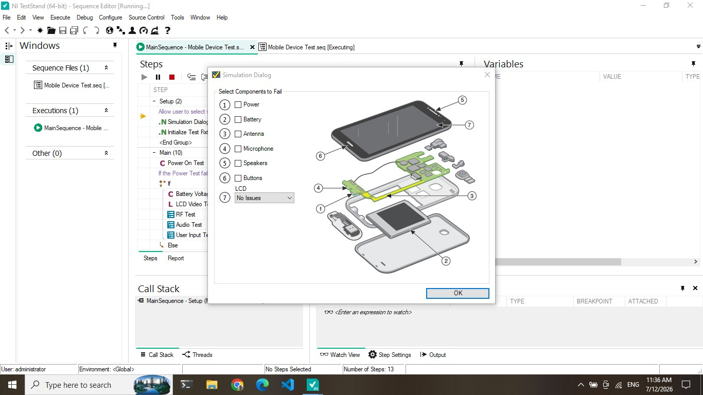
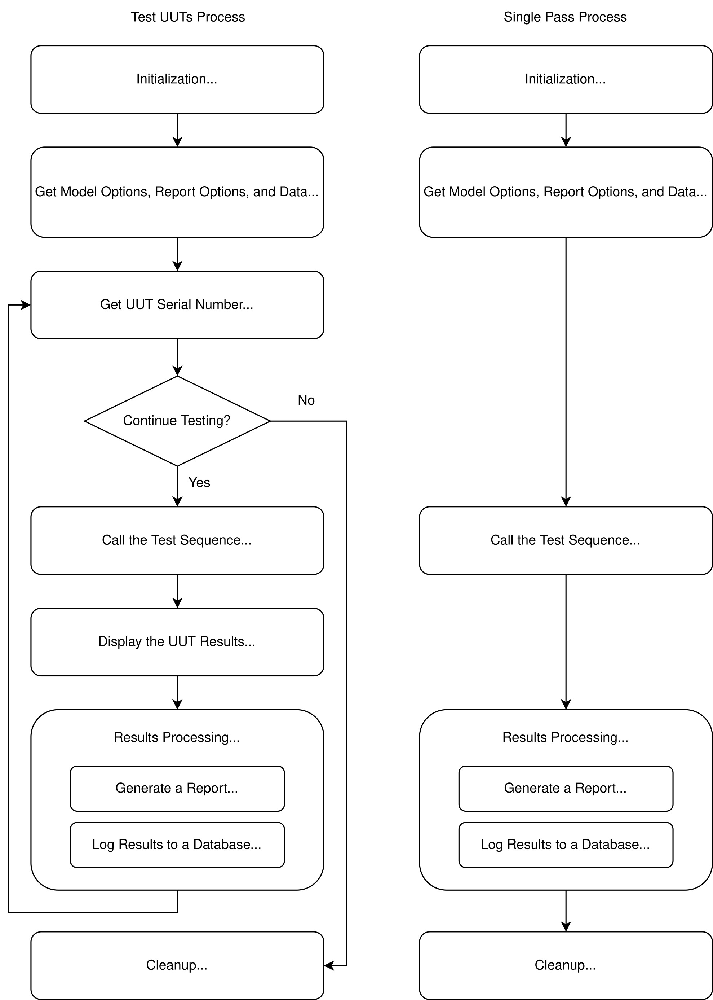
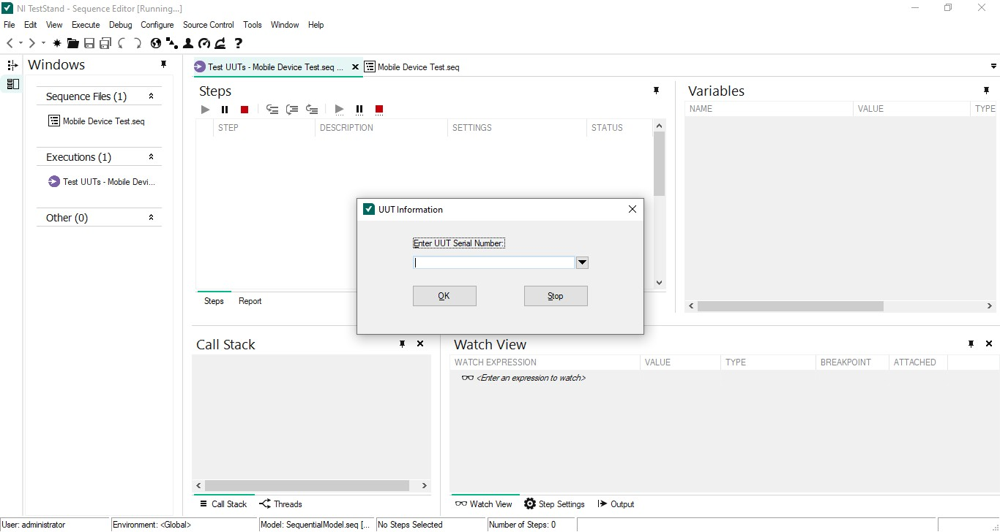
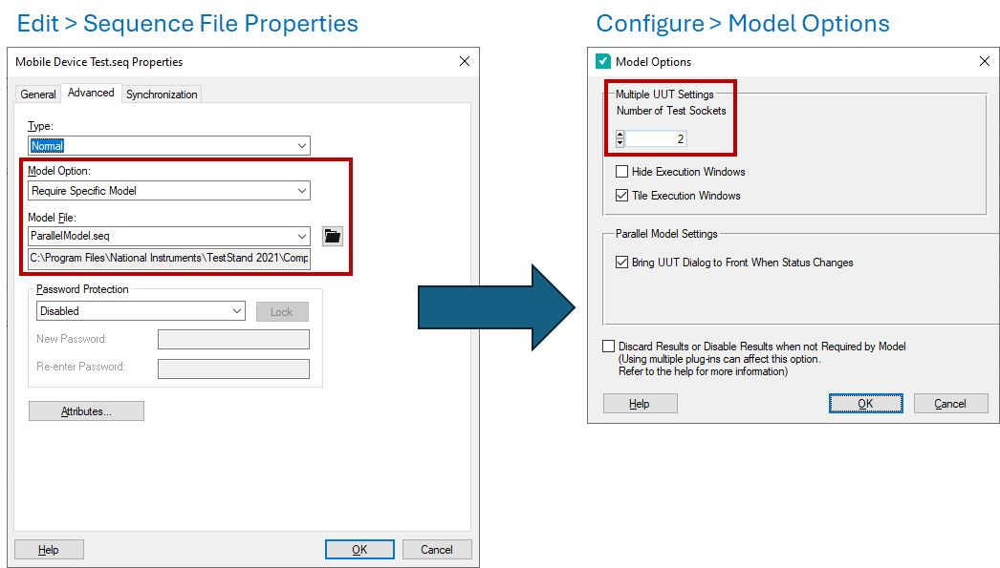
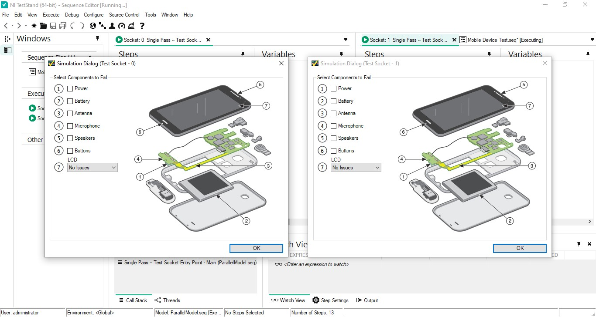
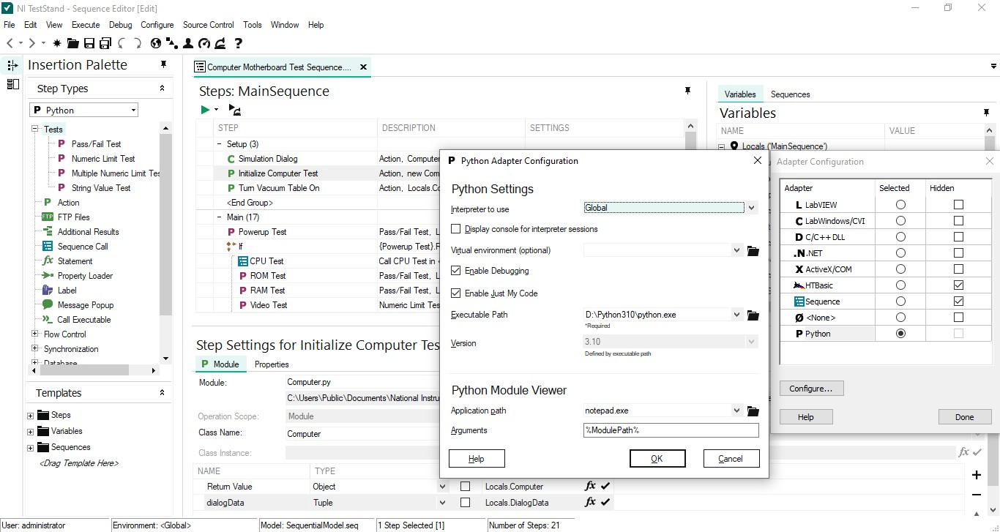

## NI TestStand {.smaller}
Off-the-shelf test management software (development/execution/deployment) for validation and production test

\

## Running TestStand example {.smaller}

:::: {.columns}
::: {.column width=77%}
\
:::
::: {.column width=23%}
#### Try example
1. Open Examples > Demos > Mobile Device Test
2. Execute > Run MainSequence

#### Debugging
1. Set breakpoint
2. Step into/over module 
:::
::::

## TestStand terminology {.smaller}

| keywords | details |
| -- | ----- |
| **Sequence**:   ordered list of **steps** | - **Step Groups**: Setup / Main / Cleanup   - **Variables**: Parameters / Locals / FileGlobals / StationGlobals |
| **Adapters** | connect Steps to Code Modules (LabVIEW, Python, C/C++ DLL, .NET) |
| **Step Types** | - **Tests**: Pass/Fail, Numeric Limit, Multiple Numeric Limit, String Value   - **Action**: execute without automatic limit evaluation   - **Sequence Call**: call a reusable Sequence   - **Statement**: evaluate expressions and update variables   - **Flow Control**: If–Else, For, While, Do–While, Sweep |
| **Execution options**:   Test UUTs, Single-pass, MainSequence | **Results**: Status, measurements, limits, report, database |

## Process model {.smaller .scrollable}

\

## Test UUTs execution {.smaller}

\

## Process models {.smaller}
:::: {.columns}
::: {.column width=50%}
**Execution**: Test UUTs, Single-pass, MainSequence
:::
::: {.column width=50%}
**Model**: sequential, batch, parallel
:::
::::

\

## Parallel model {.smaller}
\

## Python adaptors {.smaller}
#### ทดลองตัวอย่าง Computer Motherboard Test แบบ Python

:::: {.columns}
::: {.column width=65%}
\
:::
::: {.column width=35%}
1. ติดตั้ง Python
    - ใช้ standalone installer หรือ embedded packages
    - ติดตั้งแบบ admin และเพิ่มเข้าสู่ PATH
2. ใช้ Configure > Adaptors เลือก Python
:::
::::

## TestStand + (LabVIEW/...) &rarr; ATE {.smaller}
Computer-controlled systems that automatically measure and evaluate functional, structural, or electrical performance on electronic devices

| Goals | LabVIEW | TestStand |
| - | -- | -- |
| Connectivity | Direct access via DAQmx, VISA, PXI, proprietary drivers | Adapters for code modules (C/C++ DLL, Python, LabVIEW) |
| Usability | Fully customizable FrontPanel with custom .CTL | TS Operator interface, call sequence from LabVIEW |
| Reusability | SubVI, libraries (.llb), .CTL files | Module adapters, Code modules, SubSequence |
| Maintainability | Patterns for single project  | Sequence for multiple projects |
| Scalability | Single DUT | Multi-DUT, multi-station |