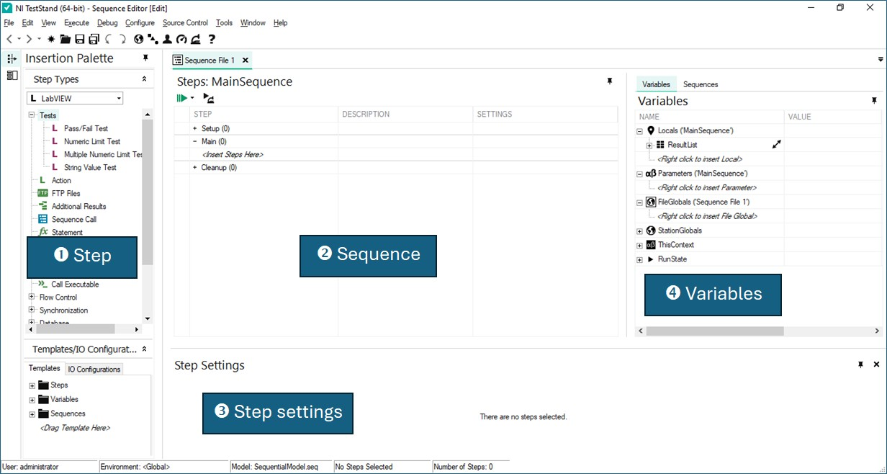
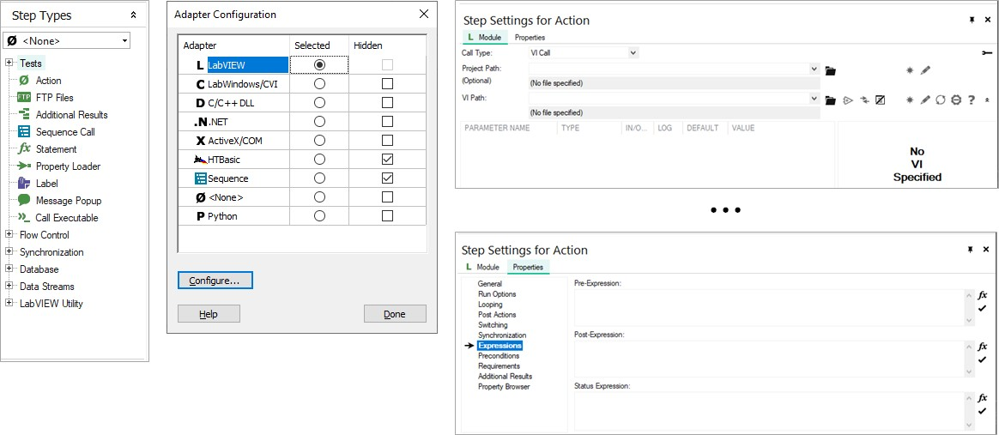
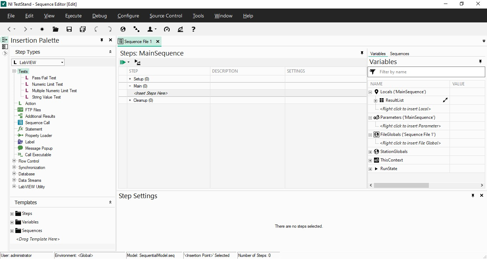
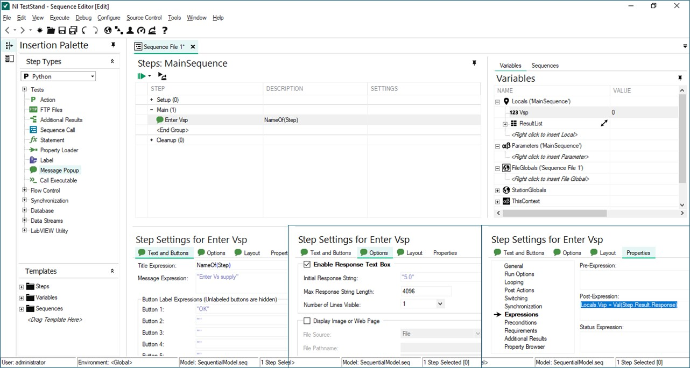
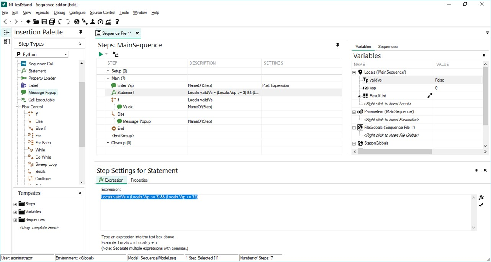
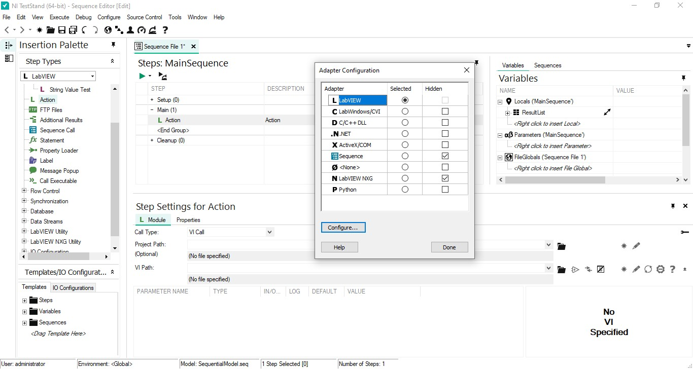
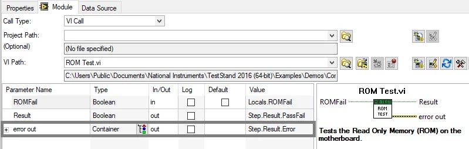
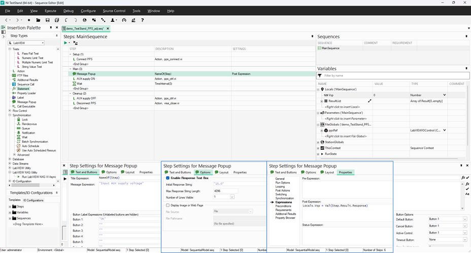
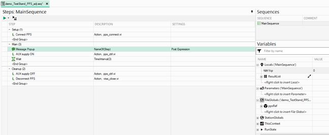
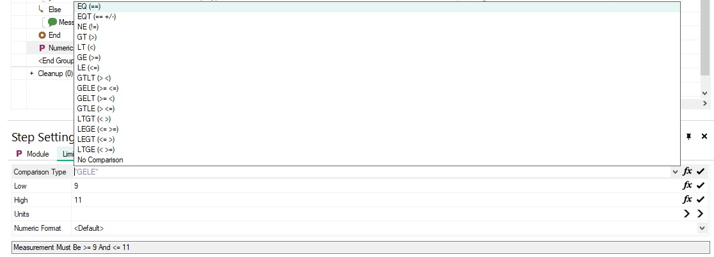

## NI TestStand: UI {.smaller}
\

## NI TestStand: Step {.smaller}

**Step** = adaptor + properties

- **Statement**: คำสั่งที่ใกล้เคียงภาษา C/C++ (ยกเว้น `str+str` การใช้ `,` คั่นคำสั่ง)
- **Sequence call**: กลุ่มของ step สำหรับการทำงานเฉพาะ

\

## NI TestStand: dev workflow {.smaller}
:::: {.columns}
::: {.column width=70%}
\
:::
::: {.column width=30%}
#### MainSequence
1. Add steps
    - Setup group
    - Main group
    - Cleanup group
2. Declare variables
    - Locals
    - FileGlobals
    - StationGlobals
3. Invoke code modules
    - Parameters
4. Run
:::
::::

## TestStand tutorial: basics {.smaller}
#### สร้าง Sequence รับและตรวจสอบค่า $V_S$
:::: {.columns}
::: {.column width=65%}
\
:::
::: {.column width=35%}
1. เพิ่ม **Message Popup** ใน **Main group** แสดงข้อความ "Enter Vs supply"
    - เลือกใช้ **Enable Response Text Box** &rarr; ตัวแปรชั่วครู่ `Step.Result.Response`
2. เพิ่ม `Vsp` เป็น **Locals** variable
    - กำหนด Properties > Expressions > Post-Expression:
`Locals.Vsp = Val(Step.Result.Response)`
2. ใช้ Breakpoint + Step over ตรวจสอบการรับค่า `Locals.Vsp`
:::
::::

## TestStand tutorial: basics {.smaller}
#### สร้าง Sequence รับและตรวจสอบค่า $V_S$

:::: {.columns}
::: {.column width=65%}
\
:::
::: {.column width=35%}
4. เพิ่ม `validVs` เป็น **Locals** variable แบบ boolean
5. เพิ่ม **Statement** ตรวจสอบ: `Locals.validVs = (Locals.Vsp >= 3) && (Locals.Vsp <= 32)`
6. เพิ่ม Flow Control แบบ **If-Else-End** โดยใช้ `Locals.validVs` เป็นเงื่อนไข
    - **True**: Message Popup "Vs OK"
    - **False**: Message Popup "Vs not in range"
:::
::::

## Code modules {.smaller}
**Program module** with one or more functions that perform a specific test or other action. 

- **Module adapters** (menu **Configure** > **Adapters**) load and call code modules, pass parameters to code modules, and return values and status from code modules.
{width=80%}\

## TestStand &lrarr; code modules^[[TestStand Code Module Development Best Practices](https://www.ni.com/en/support/documentation/supplemental/09/teststand-code-module-development-best-practices.html)] {.smaller}
:::: {.columns}
::: {.column width=50%}
#### Parameters

- **Pass-by-reference**: two-way data exchange
- Pass-by-value
:::
::: {.column width=50%}
#### Variables: scope

- **Locals**: within sequence
- **FileGlobals**: within sequence file
- **StationGlobals**: within machine
:::
::::

\

## TestStand tutorial: PPS control {.smaller}
#### สร้าง Sequence สำหรับจ่ายไฟเลี้ยง AUX opamp 3 วินาทีแล้วปิด

1. เพิ่ม  **Message Popup** &rarr;  `Locals.Vsp` และ `FileGlobals.ppsRef`
{width=90%}\

## TestStand tutorial: PPS control {.smaller}
#### สร้าง Sequence สำหรับจ่ายไฟเลี้ยง AUX opamp 3 วินาทีแล้วปิด

:::: {.columns}
::: {.column width=65%}
\
:::
::: {.column width=35%}
2. เพื่ม action ใน **Setup group** 
    - VI `pps_connect` &rarr; `FileGlobals.ppsRef`
3. เพื่ม action ใน **Main group** 
    - VI `pps_ctrl` &larr; `Locals.Vsp`
    - เพิ่ม **Wait** 3 วินาทีจาก Synchronization
4. เพื่ม action ใน **Cleanup group** 
    - เรียกใช้ `visa_close` 
5. ตรวจสอบหน้าจอ UDP3305S ตอน Run MainSequence
:::
::::

## Test steps {.smaller}

:::: {.columns}
::: {.column width=47%}
- **Pass/Fail Test**: ตรวจสอบ `Step.Result.PassFail`
- **Numeric Limit Test**: เปรียบเทียบ `Step.Result.Numeric` กับค่า Limit
:::
::: {.column width=53%}
- **Multiple Numeric Limit Test**: เปรียบเทียบอะเรย์ `Step.Result.Measurement` กับ Limits
- **String Value Test**: ใช้เงื่อนไข string/regEx กับ `Step.Result.String`
:::
::::
\

