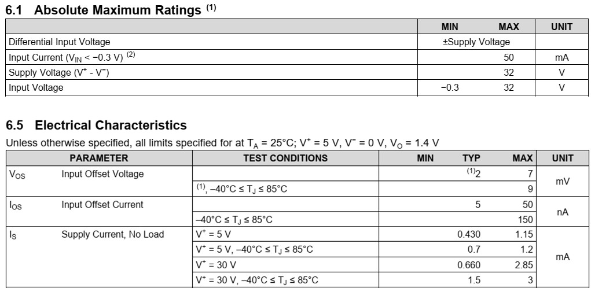
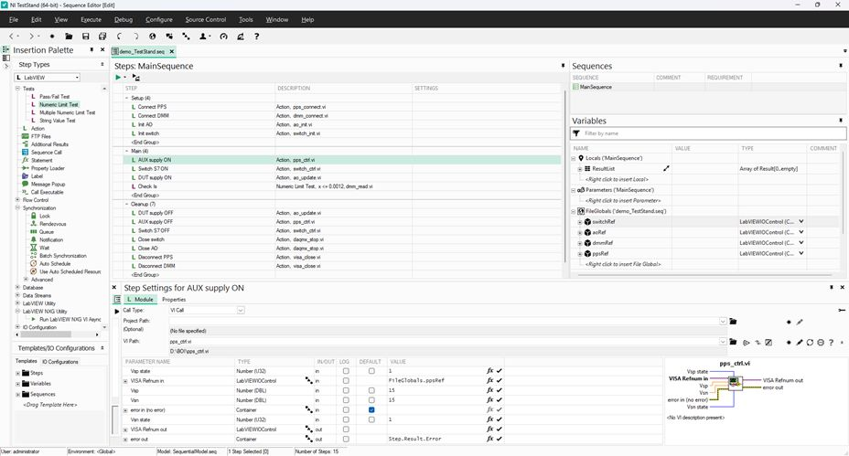

## LM321 specification {.smaller}

\

## $I_{S}$ measurement {.smaller}

:::: {.columns}
::: {.column width=50%}
1. **UDP3305S**: จ่ายไฟเลี้ยง CH1(15V)/CH2(15V)
2. **UT8805E**: วัดกระแส DC ย่าน 20 mA
:::
::: {.column width=50%}
3. **NI-9477**: คุมสวิทช์ S7
4. **NI-9269**: จ่ายไฟเลี้ยง AO0(5V)/AO1(5V)
:::
::::
\

## TestStand practice: $I_{S}$ measurement {.smaller}

| Group | Code modules | Function | Variables | 
| :- | :- | :---- | :-- |
| **Setup** | `pps_connect`   `dmm_connect`   `switch_init`   `ao_init` | เชื่อมต่อ UDP3305S   เชื่อมต่อ UT8805E   เชื่อมต่อ NI-9477   เชื่อมต่อ NI-9269 | &rarr; `FG.ppsRef`^[VISA/DAQmx resource เป็น [`LabVIEWIOControl` type](https://knowledge.ni.com/KnowledgeArticleDetails?id=kA03q000000YGp8CAG&l=en-TH)]   &rarr; `FG.dmmRef`^[LC คือ Locals, FG คือ FileGlobals, SG คือ StationGlobals]   &rarr; `FG.switchRef`   &rarr; `FG.aoRef` | 
| **Main** | `pps_ctrl`   `switch_ctrl`   `ao_update`   Numeric Limit Test (`dmm_read`) | จ่ายไฟเลี้ยง ±15V ให้ AUX   เปิดสวิทช์ S7   จ่ายไฟเลี้ยง ±5V ให้ DUT   ทดสอบ $I_{S}$ < 1.2mA |  |
| **Cleanup** |`visa_close`   `daqmx_stop` | ปิดการเชื่อมต่อ VISA   ปิดการเชื่อมต่อ DAQmx | &larr; ...   &larr; ...  |

## TestStand practice {.smaller}
\

## TestStand practice: sequence call {.smaller}

| Group | Code modules | Function | Variables | 
| :- | :-- | :--- | :-- |
| **Setup** | ... | ... | ... |
| **Main** | `pps_ctrl`   `ao_update`   Call `I_S_test` | จ่ายไฟเลี้ยง ±15V ให้ AUX   จ่ายไฟเลี้ยง ±5V ให้ DUT   ทดสอบ $I_{S}$ < 1.2mA | ... |
| **Cleanup** | ... | ... | ... |

 

:::: {.columns}
::: {.column width=20%}
#### Sub-sequence: "I_S test"
:::
::: {.column width=75%}

::: {style="border: 2px solid black; padding: 10px; display: inline-block;"}

| Group | Code modules | Function | 
| :- | :--- | :--- |
| **Setup** | `switch_ctrl` | เปิดสวิทช์ S7 | 
| **Main** | Numeric Limit Test (`dmm_read`) | ทดสอบ $I_{S}$ < 1.2mA |
| **Cleanup** |`switch_ctrl` | ปิดสวิทช์ S7 | 

:::

:::
::::