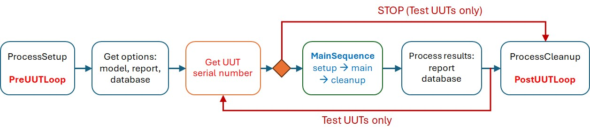
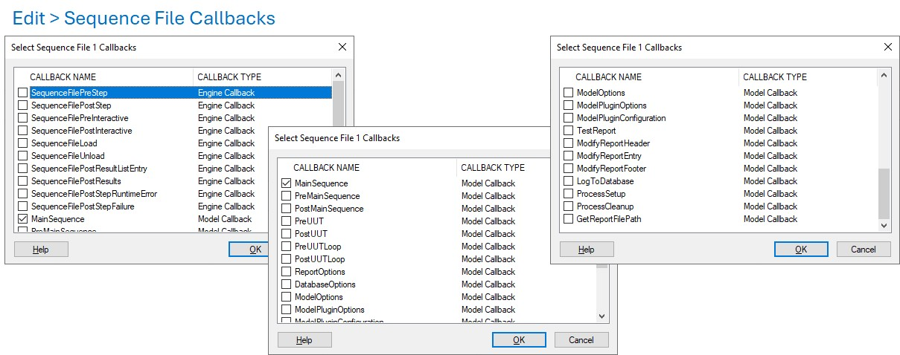
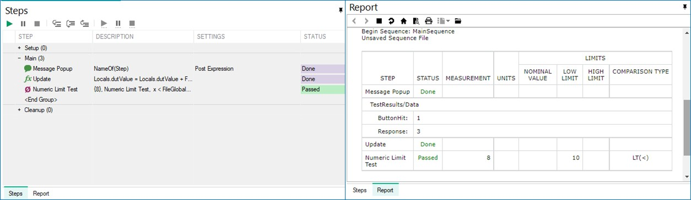

## Running TestStand {.smaller}
:::: {.columns}
::: {.column width=35%}
#### Execution
- [ ] Test UUTs
- [ ] Single Pass
- [ ] Run MainSequence
:::
::: {.column width=65%}
#### Process model
- **Sequential model** (default): test one UUT at a time
- **Batch model**: run common steps for each batch, not for each UUT
- **Parallel model**: run multiple independent test sequences
:::
::::
\

## TestStand sequence callbacks {.smaller}
**MainSequence**: Setup &rarr; Main &rarr; Cleanup

\

## Test results and data logging {.smaller}

Process model &rarr; MainSequence (Test Steps) &rarr; **Step results** 

:::: {.columns}
::: {.column width=33%}
#### Report
- HTML / XML
- Automatic generation
- Review test results
- Debug & traceability
:::
::: {.column width=33%}
#### Logging
- SQL database
- Manufacturing records
- Yield analysis
:::
::: {.column width=34%}
#### Data Streams
- CSV Input/Output
- Configuration
- Custom logging
:::
::::
{width=90%}\

## TestStand process tutorial {.smaller}
1. เมนู Edit > Sequence File Callbacks เพิ่มตัวเลือก `ProcessSetup`, `ProcessCleanup`, `PreUUT` และ `PostUUT`
2. กำหนดตัวแปรสำหรับจัดการข้อมูลใน **MainSequence**
    - **FileGlobals**: `SerialNumber` (String), `Offset` (Number), `Limit` (Number)
    - **Locals**: `dutValue` (Number)
3. กำหนด step สำหรับการทำงาน

| Callbacks | Operations | 
| :- | :------ |
| `ProcessSetup` | เพิ่ม **Message Popup** รับค่า `FileGlobals.Offset` |
| `PreUUT` | เพิ่ม **Statement**   `FileGlobals.SerialNumber = Parameters.UUT.SerialNumber` |

4. ใช้ breakpoint และ step over เพื่อตรวจสอบการรับค่า

## TestStand process tutorial {.smaller .scrollable}
5. กำหนดตัวแปร **Locals** สำหรับการจัดการข้อมูลใน **PreUUT**
    - `Locals.csvRef` (Object Reference) และ `rowData` (Container) 
    - เพิ่มสมาชิก `SerialNumber` (String) และ `Limit` (Number) ให้ตัวแปร `rowData`

6. กำหนด step ใน `PreUUT` เพื่อนำเข้าค่า Limit

| Callbacks | Operations | 
| :- | :------ |
| `PreUUT` | เพิ่ม **New CSV Input Stream** เพื่ออ้างถึงไฟล์ CSV   - ระบุตำแหน่งไฟล์   - กำหนด **Input Record Stream Reference** เป็น `Locals.csvRef`   - กำหนด **Field Mapping** เป็น "0,1" |
|  | เพิ่ม **Stream Loop** สำหรับวนแยกข้อมูล   - กำหนด **Input Record Stream** เป็น `Locals.csvRef`   - กำหนด **Input Record** เป็น `Locals.rowData` |
| (**Stream Loop**) | เพิ่ม **If-End** ตรวจสอบเงื่อนไข   `FileGlobals.SerialNumber == Locals.rowData.SerialNumber` |
| (**If-End**) | เพิ่ม **Statement** อัพเดทค่า Limit   `FileGlobals.Limit = Locals.rowData.Limit` |
| | เพิ่ม **Break** เพื่อจบ loop |

## TestStand process tutorial {.smaller}
7. กำหนด step ใน `MainSequence` เพื่อรับและตรวจสอบค่า Limit

| Callbacks | Operations | 
| :- | :------ |
| `MainSequence` | เพิ่ม **Message Popup** รับค่า `Locals.dutValue` | 
| | เพิ่ม **Statement** คำนวณค่า `dutValue`   `Locals.dutValue = Locals.dutValue + FileGlobals.Offset`
| | เพิ่ม **Numeric Limit Test** ทดสอบว่า dutValue < Limit   - เมนู Config > Adaptors เลือกเป็น **None**   - กำหนด **Data Source** เป็น `Locals.dutValue`   - กำหนดเงื่อนไข **LE (<)** โดยตั้งค่าเป็น `FileGlobals.Limit` |

8. ทดสอบป้อนค่าให้ครอบคลุม Pass/Fail

## TestStand process tutorial {.smaller .scrollable}

9. กำหนดตัวแปร **Locals** สำหรับการจัดการข้อมูลใน **PostUUT**

    - `Locals.csvRef` (Object Reference) และ `logData` (Container)
    - เพิ่มสมาชิก `idx` (Number), `SN` (String) และ `Status` (String) ให้ตัวแปร `logData`

10. กำหนด step ใน `PostUUT` เพื่อบันทึกผลในไฟล์ CSV

| Callbacks | Operations | 
| :- | :------ |
| `PostUUT` | เพิ่ม **New CSV Output Stream** เพื่ออ้างถึงไฟล์ CSV   - ระบุตำแหน่งไฟล์   - กำหนด **Output Record Stream Reference** เป็น `Locals.csvRef`   - กำหนด **Field Mapping** เป็น "0,1,2" | 
| | เพิ่ม **Statement** สำหรับเตรียมข้อมูล^[เว้น expression โดยใช้ **,** (comma)]   `Locals.logData.index = Parameters.UUT.UUTLoopIndex,`   `Locals.logData.SN = Parameters.UUT.SerialNumber,`   `Locals.logData.status = Parameters.Result.Status` |
| | เพิ่ม **Write Record** เพื่อเขียนข้อมูล   - กำหนด **Output Record Stream** เป็น `Locals.csvRef`   - กำหนด **Record** เป็น `Locals.rowData` |

11. ทดสอบป้อนค่าให้ครอบคลุม Pass/Fail

## Test sequence for LM321 opamp {.smaller}
:::: {.columns}
::: {.column width=50%}
- เงื่อนไขการทดสอบ $V_S$ = ±5V
- Supply current $I_S$ < 1.2 mA
::: 
::: {.column width=50%}
- Offset voltage $V_{OS}$ < 9 mV 
- PSRR > 65 dB  
:::
::::

| Callback | Code modules | Function | Variables | 
| :-- | :--- | :--- | :--- |
| ProcessSetup | `pps_connect`   `dmm_connect`   `switch_init`   `ao_init`   `ai_init` | เชื่อมต่อ UDP3305S   เชื่อมต่อ UT8805E   เชื่อมต่อ NI-9477   เชื่อมต่อ NI-9269   เชื่อมต่อ NI-9239| &rarr; `FG.ppsRef`   &rarr; `FG.dmmRef`   &rarr; `FG.switchRef`   &rarr; `FG.aoRef`   &rarr; `FG.aiRef` |
| MainSequence | `pps_ctrl`   `ao_update`   NumTest `ai_measure`   `switch_ctrl`   NumTest `dmm_read` | ไฟเลี้ยง AUX ±15V   ไฟเลี้ยง DUT ±5V   ทดสอบ $V$ < 9V   เปิดสวิทช์ S7   ทดสอบ $I_{S}$ < 1.2mA | |
| ProcessCleanup | `visa_close`   `daqmx_stop` | ปิด VISA   ปิด DAQmx | &larr; ...   &larr; ...  |
