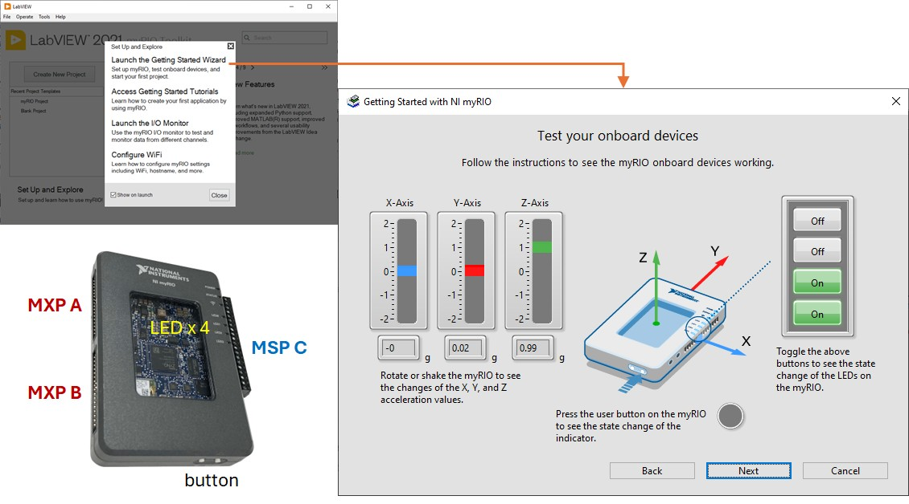
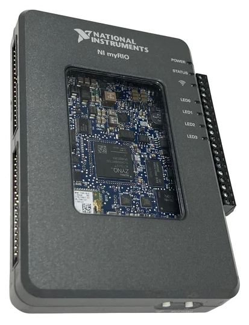
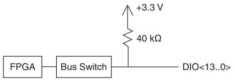
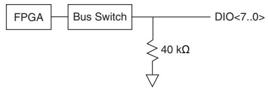
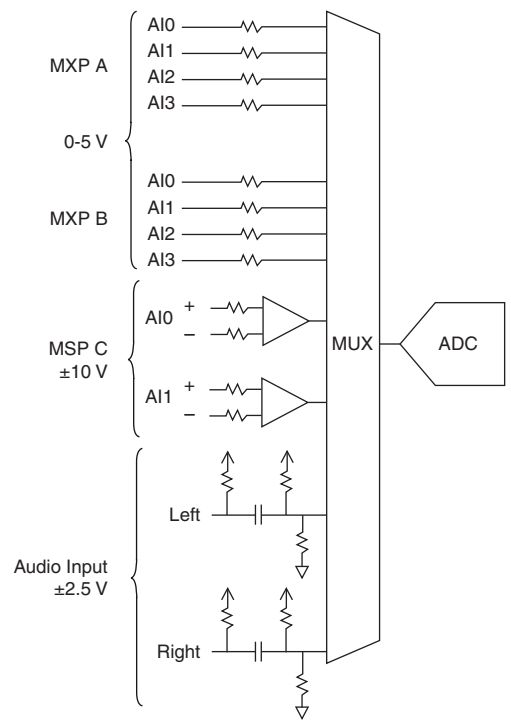
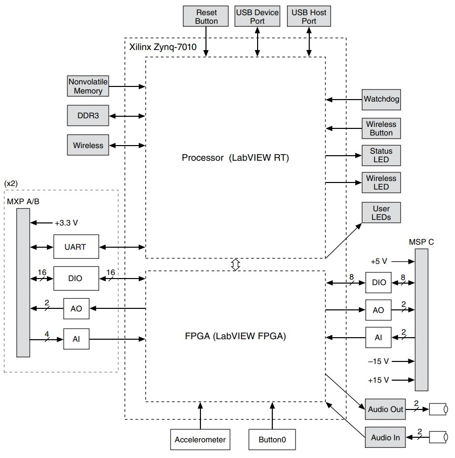
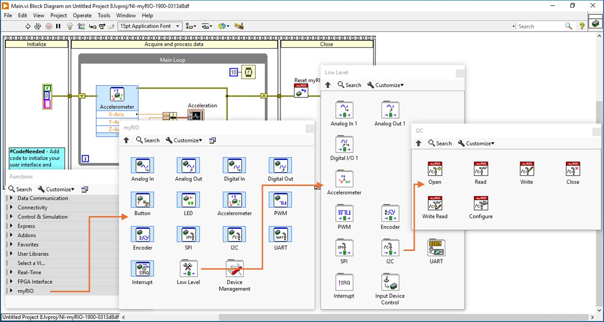
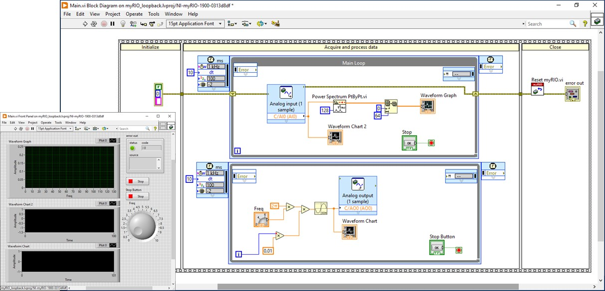
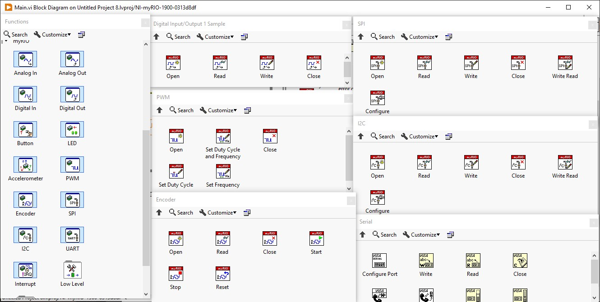

## NI myRIO {.smaller}
\

## NI myRIO {.smaller}
:::: {.columns}
::: {.column width=25%}
\
\
\
:::
::: {.column width=35%}
\
:::
::: {.column width=40%}
#### myRIO-1900

- **Analog Input (AI)**:
    - 12-bit, aggregated 500 kS/s
    - MXP: 4 single-ended, 0-5V
    - MSP: 2 differential, &plusmn;10V
- **Analog output (AO)**:
    - MXP A/B: 2 single-ended, 0-5V
    - MSP C: 2 single-ended, &plusmn;10V
- **Digital I/O (DIO)**:
    - MXP (2 x 16 pins), MSP (8 pins)
:::
::::

## myRIO hardware/software arch {.smaller}
:::: {.columns}
::: {.column width=60%}
\
:::
::: {.column width=40%}
#### Zynq-7010 SoC
- **Dual-core ARM Cortex-A9**:
    - 256MB RAM + 512MB Flash
    - Linux RT kernel 4.14
    - SSH: admin:no password

- **Artix-7 FPGA**:
    - 28k logic cells
    - 240KB block RAM
:::
::::

## myRIO in LabVIEW {.smaller}
\

## myRIO quick tutorial {.smaller}
**ลองสร้าง signal processing โดยใช้ analog loopback**

- Analog input/output + parallel timed loop + Pt-by-Pt power spectrum 

\

## myRIO digital: I/O, timed, comm. {.smaller}

\
