## Problem-based learning #1 {.smaller}

:::: {.columns}
::: {.column width=55%}
#### [ADS1115](https://www.ti.com/product/ADS1115) ADC module as DUT

- 16-bit Delta-Sigma: upto 860 Samples/sec
- 2 differential inputs or 4 single-ended inputs
- Programmable Gain Amplifier (PGA): ±256mV to ±6.144V
- Supply voltage: upto 5.5V
- Comparator &rarr; ALERT/RDY pin
:::
::: {.column width=45%}
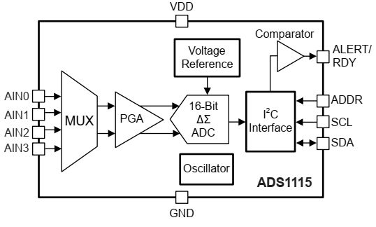\
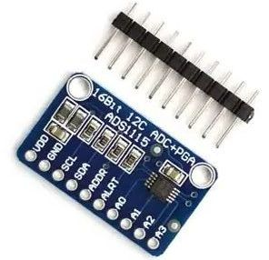\

:::
::::

## ADS1115 schematics {.smaller}
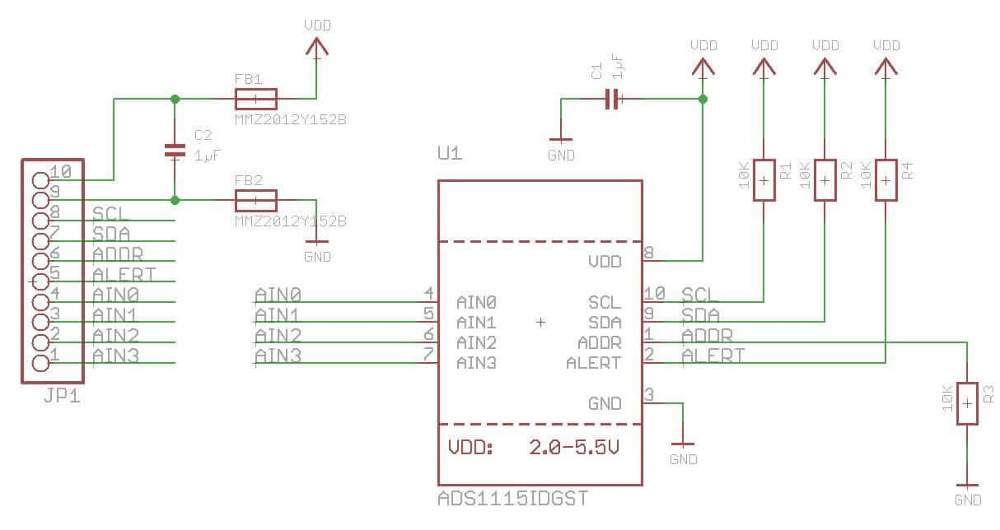\

## ADS1115 operations {.smaller}
:::: {.columns}
::: {.column width=50%}
#### Multiplexer (MUX): 
- Singled-ended, differential
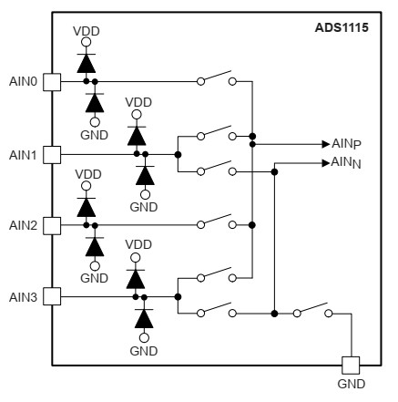\
:::
::: {.column width=50%}
#### Programmable Gain Amplifier (PGA):
- $LSB = \frac{FSR}{2^{16}}$
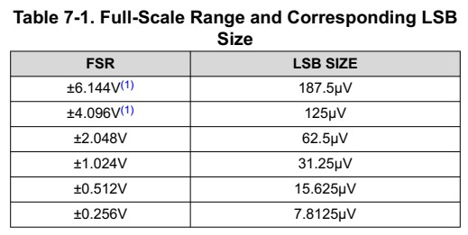\
:::
::::

## I2C write &rarr; ADS1115 {.smaller}
- I2C bus: half-duplex, master-slave (7-bit dev address + R/W bit)
- I2C device: registers for control/status/data
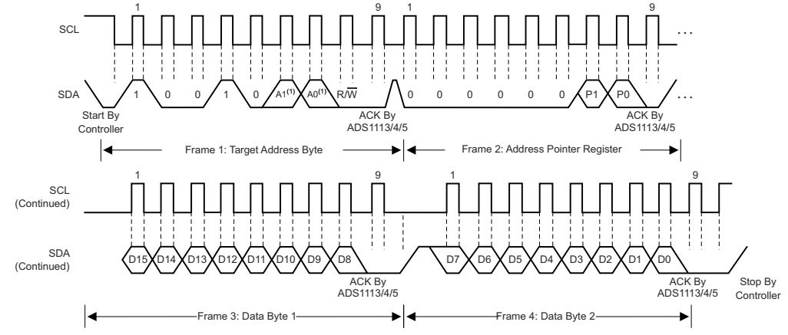\

## I2C read &larr; ADS1115 {.smaller}
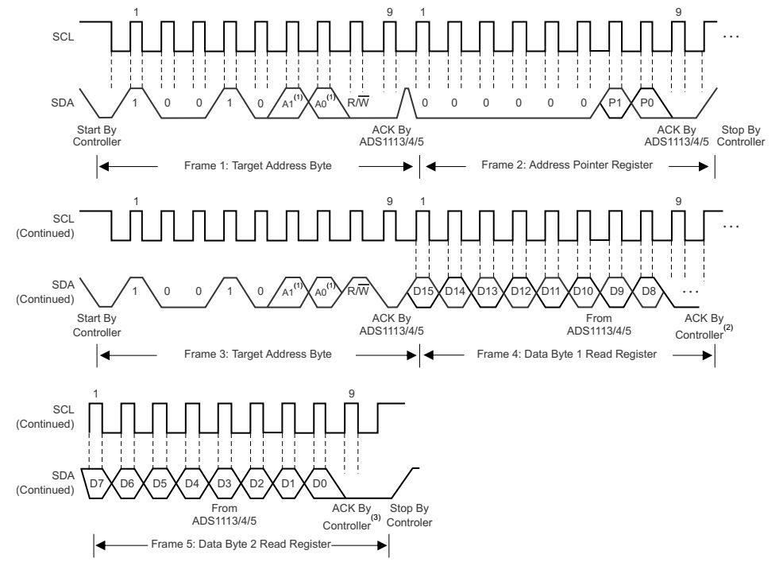{width=80%}\

## Programming ADS1115 {.smaller}
:::: {.columns}
::: {.column width=50%}
#### Configure modes
- write(device address+W) + address pointer + (MSB/LSB) payload
:::
::: {.column width=50%}
#### Read data
- write(device address+W) + address pointer
- read(device address+R) + 2-byte payload
:::
::::

#### Device address (7bit) ขึ้นกับขา ADDR
- GND (1001000) หรือ VDD (1001001)

#### Address Pointer
| Register | Address  | Function  |  
| -- | -- | ------- |
| Conversion  | 00b | ข้อมูล 16 บิตล่าสุด |
| Config | 01b | ตั้งโหมด เลือกอินพุต ตั้งอัตราสุ่ม กำหนดย่าน ตั้ง comparator |
| Low Thres | 10b | กำหนดเงื่อนไขช่วงต่ำ &rarr; ALERT |
| High Thres | 11b | กำหนดเงื่อนไขช่วงสูง &rarr; ALERT |

## LabVIEW + myRIO &lrarr; ADS1115 {.smaller}
:::: {.columns}
::: {.column width=50%}
#### ADDR pin to Device Address
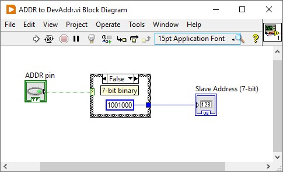{width=70%}\
:::
::: {.column width=50%}
#### Address Pointer to 8-bit
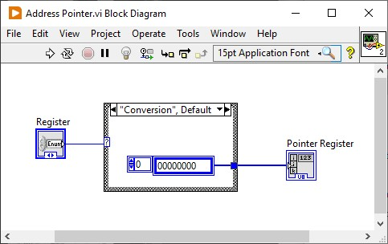{width=70%}\
:::
::::

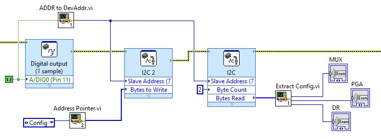\

## LabVIEW + myRIO &lrarr; ADS1115 {.smaller}
:::: {.columns}
::: {.column width=60%}
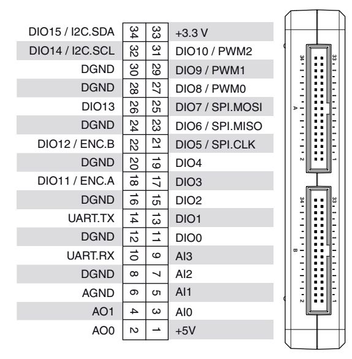\
:::
::: {.column width=40%}
#### Pin interfaces
| myRIO | ADS1115 | 
| -- | -- |
| 1 (5V) | VCC |
|8 (DGND) | GND |
| 32 (DIO14/I2C.SCL) | SCL |
| 34 (DIO15/I2C.SDA) | SDA |
| 11 (DIO0) | ADDR |
| 13 (DIO1) | ALRT |
| 2 (AO0) | A0 |
| 4 (AO1) | A1 |
:::
::::

## Testing ADS1115 module {.smaller}
:::: {.columns}
::: {.column width=30%}
{width=65%}\

#### Spring-loaded pogo pins
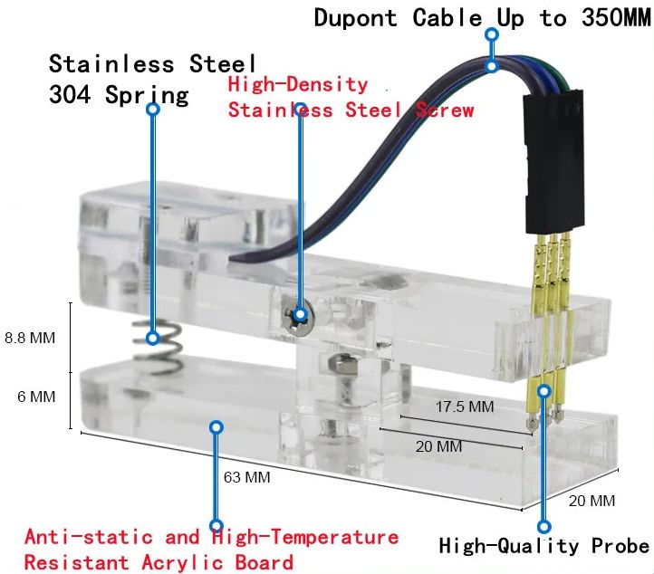\
:::
::: {.column width=70%}
#### Basic test
- Power-on test: VDD = 5V, GND

#### Digital test
- I2C comm test: 
- Device address test: ADDR pin = 0/1
- Configuration test: write/read Config register
- ADC value test: start conversion, read data

#### Analog test
- Singled-ended reading: myRIO AO0 &rarr; A0 pin
- MUX swap reading: myRIO AO1 &rarr; A1 pin
- Differential reading: myRIO AO0/AO1 &rarr; A0/A1 pin
:::
::::

## Pattern: [state machine](https://www.ni.com/en/support/documentation/supplemental/16/simple-state-machine-template-documentation.html) {.smaller}
Programming architecture that allows dynamic flow to **states** depending on values from previous states or user inputs

- **Enum** หรือ **String** เป็น state &rarr; shift register คงค่าไปรอบถัดไป
- **Case structure** อยู่ใน **while loop**

\

## LabVIEW + myRIO practice {.smaller}
#### สร้าง VI สำหรับ I2C comm test

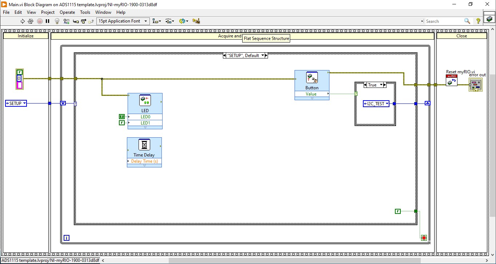\